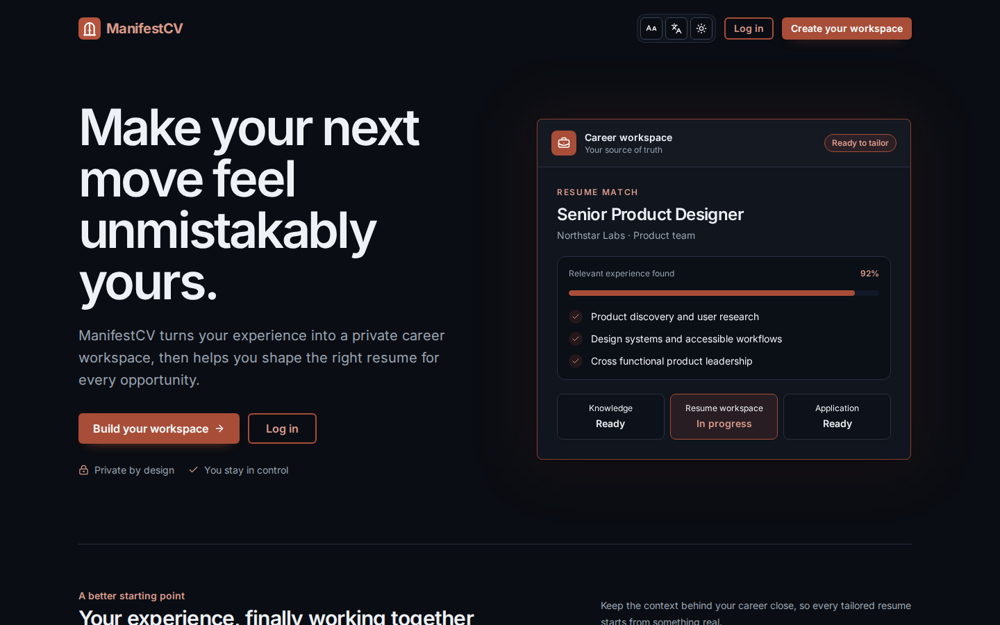
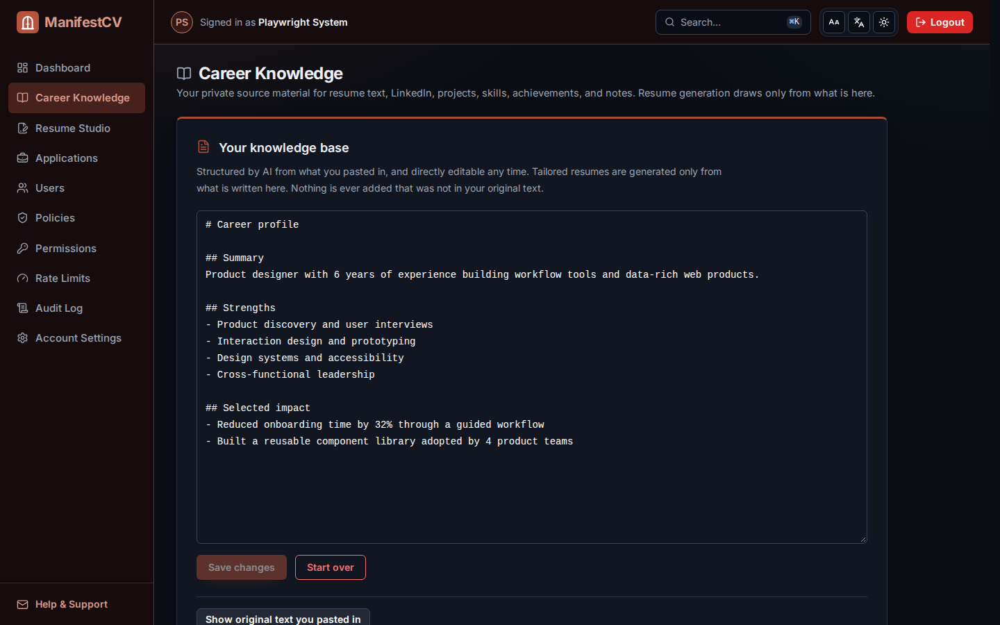
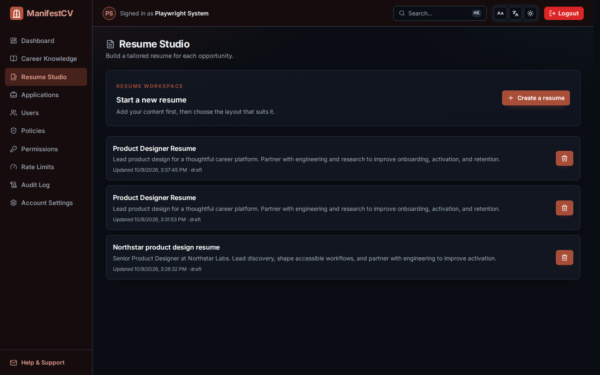
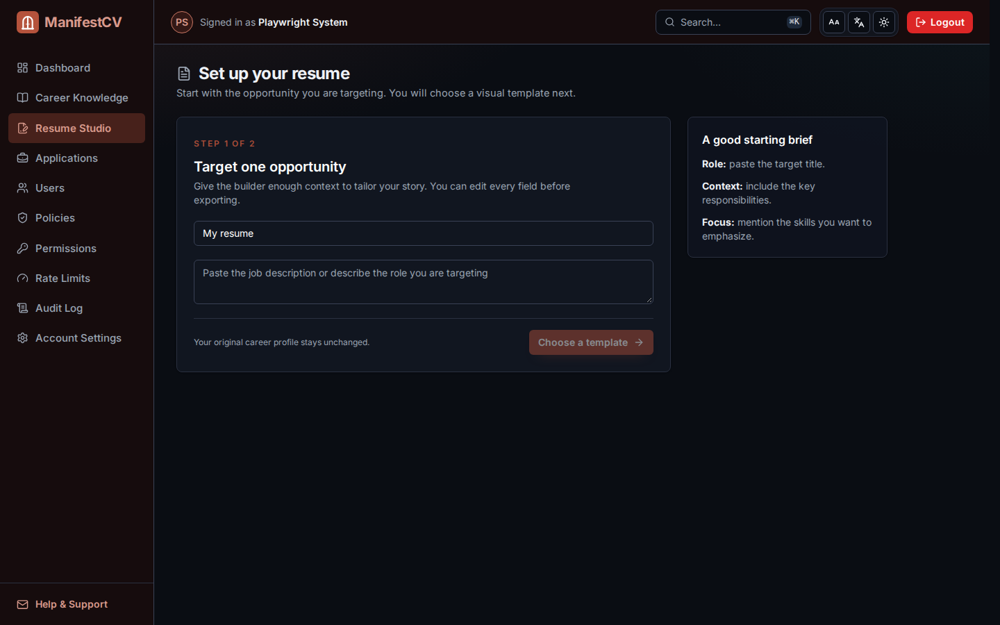
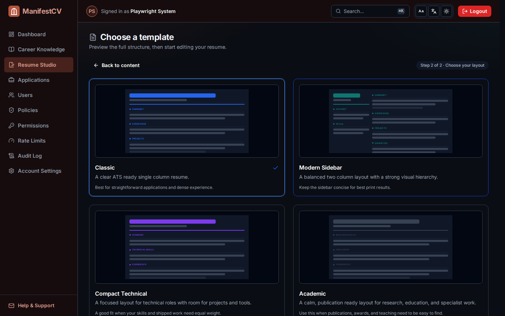
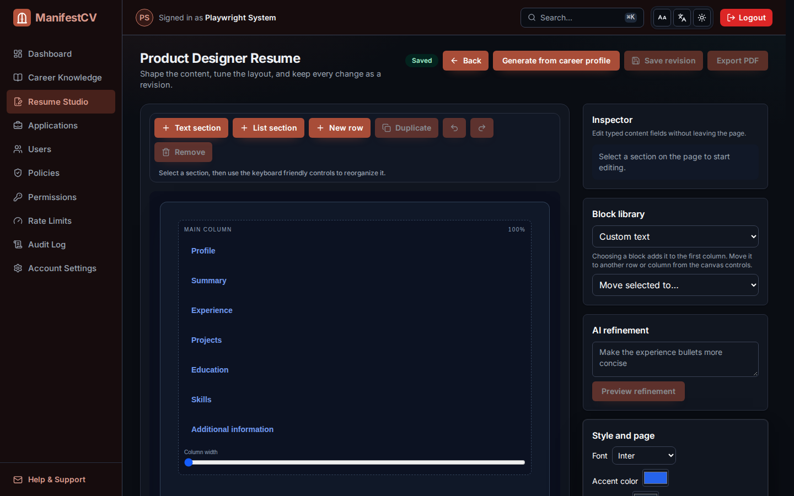
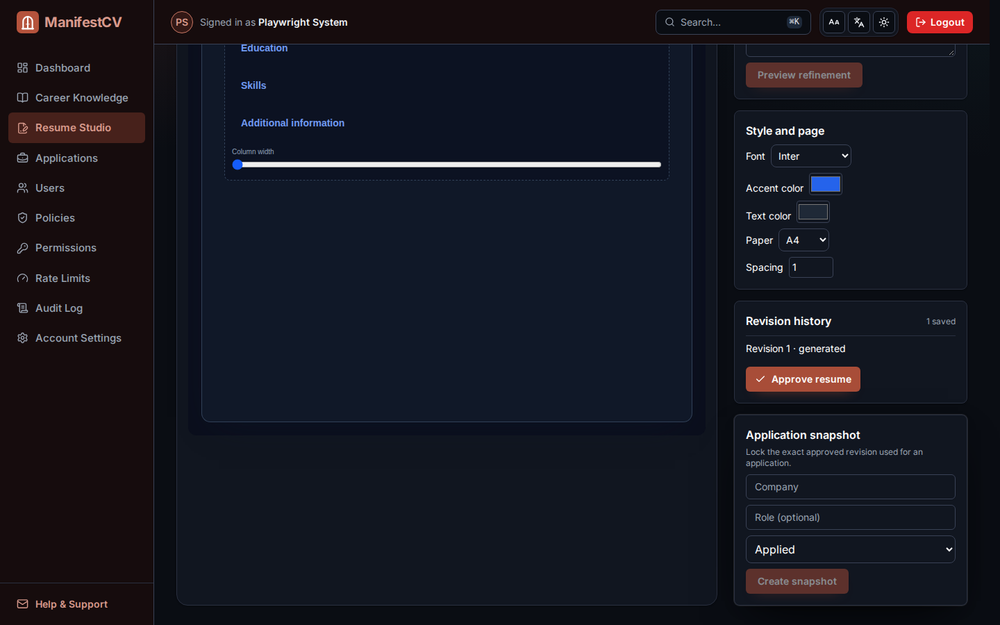
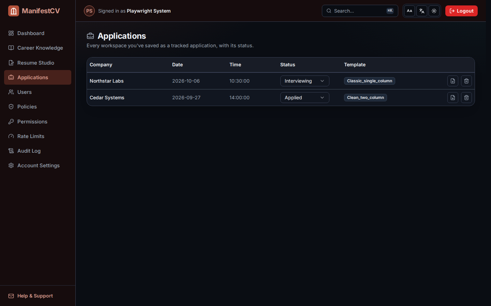
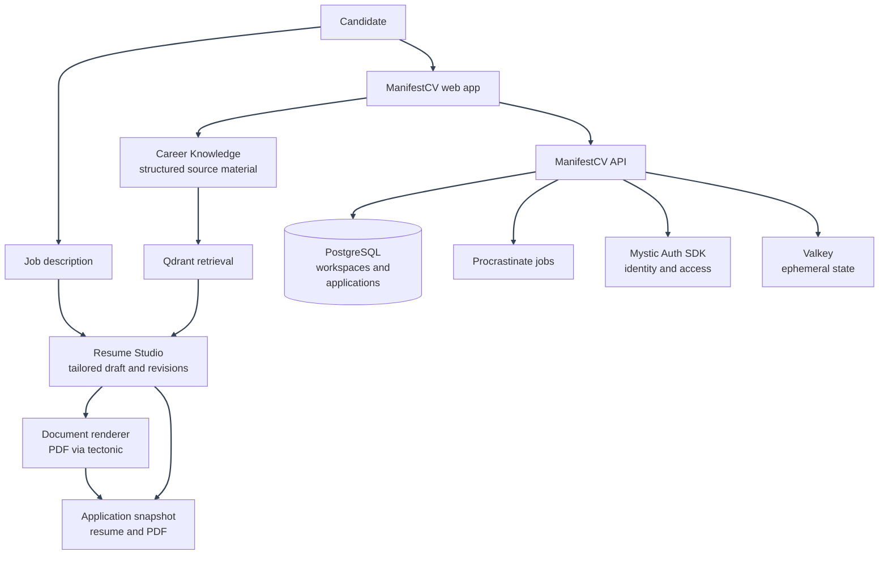

# ManifestCV


---

## Overview

ManifestCV turns one private career knowledge base into tailored, AI-assisted resumes for each job description. Paste your career material once. ManifestCV structures it, retrieves the relevant sections for each role, generates and refines a resume from them, then compiles and tracks the result.

Identity, sessions, and access control are provided by [mystic-auth](https://github.com/Nachiket-2024/mystic-auth), a full-stack auth/PBAC foundation, vendored in unmodified. See [Auth & Authorization](docs/app/auth/overview.md) for how ManifestCV is wired to it, and the [mystic-auth repository](https://github.com/Nachiket-2024/mystic-auth) itself for everything about how login, OAuth2, policy-based access control, the command palette, and bulk user/policy actions actually work.

See [`docs/README.md`](docs/README.md) for architecture, product features, database, API reference, testing, Docker, CI/CD, and deployment.

---

## Screenshots

### Product landing page



---

<details>
<summary><strong>See all 8 screenshots</strong> (landing page through applications)</summary>

---

### 1. Product landing page


---

### 2. Career Knowledge



---

### 3. Resume Studio workspace list



---

### 4. Resume Studio setup



---

### 5. Resume Studio template selection



---

### 6. Resume Studio builder



---

### 7. Resume Studio revisions and application snapshot controls



---

### 8. Applications



</details>

---

## Architecture



ManifestCV keeps the candidate's structured career knowledge as the source for
tailored resume work. A job description selects relevant knowledge, Resume
Studio generates and refines the document, and the renderer produces a PDF.
Saving an application stores the selected content, template, and PDF as a
snapshot so later workspace edits do not change application history.

Mystic Auth supplies the identity and access foundation through the SDK. The
ManifestCV API owns the product workflow and its data, while PostgreSQL stores
durable records, Qdrant supports retrieval, Valkey handles ephemeral state, and
Procrastinate runs background work. See [System Architecture](docs/app/architecture/system-overview.md)
for the product component map and [Auth & Authorization](docs/app/auth/overview.md)
for the integration boundary.

---

## Features

- **Career Knowledge Base**: paste in your resume, LinkedIn export, project notes, whatever you have. Gemini structures it into clean, editable Markdown, always directly re-editable by hand afterward. See [Career Knowledge](docs/app/career-knowledge/overview.md).
- **Semantic Retrieval**: your knowledge base is chunked and embedded into Qdrant, so resume generation retrieves only the sections relevant to a specific job description instead of dumping everything into one prompt. See [AI & Retrieval](docs/app/ai-and-retrieval/overview.md).
- **AI-Assisted Resume Studio**: start from a template, generate a tailored resume from a job description, then refine it with natural-language instructions that re-match the knowledge base. See [Resume Studio](docs/app/resumes/overview.md).
- **PDF Document Generation**: once approved, render the structured Resume Studio document to a polished PDF with the bundled `tectonic` engine. No LaTeX installation is required, and multiple visual templates are available. See [Document Generation](docs/app/document-generation/overview.md).
- **Application Tracking**: save an approved Resume Studio workspace against a job application. The resume content, template, and PDF are snapshotted at that moment, so tracked applications survive later edits to the source workspace. See [Applications](docs/app/applications/overview.md).
- **Product foundation**: ManifestCV uses Mystic Auth for identity and access, so the product has real account isolation without duplicating that infrastructure in the app layer. See [Auth & Authorization](docs/app/auth/overview.md).
- **Operational visibility**: backend and frontend exceptions are reported to self-hosted Bugsink or Sentry through the shared monitoring integration. See [Error Monitoring](docs/mystic_auth/error-monitoring/overview.md).

---

## Stack

- **Backend:** FastAPI (fully async), SQLAlchemy 2.0 (async, `asyncpg`), Alembic migrations
- **AI:** Google Gemini. Text generation (structuring, resume generation/refinement) and embeddings
- **Retrieval:** Qdrant. Self-hosted vector search over per-user career knowledge chunks
- **Document generation:** Structured document → PDF renderer → `tectonic` (self-contained compiler, no TeX Live install)
- **Authentication:** Email + Password (Argon2 hashing, JWT access & refresh tokens), Google OAuth2 with PKCE. Via mystic-auth
- **Frontend:** TypeScript, React 19 + Vite, Tailwind CSS, Radix UI
- **Translations:** English, Hindi, Marathi, and Gujarati via `react-i18next`, including mixed
  English-chrome/translated-content modes. See
  [Translations Overview](docs/mystic_auth/translations/overview/README.md)
- **State Management:** Zustand (client/session state) + TanStack Query (server state/caching)
- **Database:** PostgreSQL (async)
- **Caching & Tasks:** Valkey for ephemeral cache and security counters, plus Procrastinate for Postgres-native async background email delivery and the daily account-purge job. See [Background Email Delivery](docs/mystic_auth/background-workers/procrastinate.md).
- **Error monitoring:** Sentry SDK protocol, self-hosted Bugsink by default (or Sentry's hosted free tier)
- **Deployment:** Docker (dev, self-hosted local-prod through Cloudflare Tunnel/ngrok/Tailscale, and prod on your own server through Caddy)
- **Authorization:** Policy-Based Access Control (PBAC); new accounts get the baseline `self_service` policy plus any policy names listed in `DEFAULT_APP_POLICIES`, without modifying Mystic Auth internals. See [Auth & Authorization](docs/app/auth/overview.md)

---

## Getting started

For the quickest setup, give an AI coding agent the [ManifestCV setup prompt](agent-prompts/app/manifestcv-setup.md). It handles the paired environment files, Docker startup, health checks, product smoke checks, and Mystic Auth ownership boundaries.

If you are setting it up manually, ManifestCV runs as a Docker stack. The short development path is:

```bash
cp env/mystic_auth/.env.dev.example env/mystic_auth/.env.dev
cp env/app/.env.dev.example env/app/.env.dev
# Set APP_NAME, database values, credentials, and GEMINI_API_KEY
docker compose -f docker/mystic_auth/compose/docker-compose.dev.yml -f docker/app/compose/docker-compose.dev.yml \
  --env-file env/mystic_auth/.env.dev --env-file env/app/.env.dev up -d --build
```

Open the product at [http://localhost:5173](http://localhost:5173). The API documentation is available at [http://localhost:8000/docs](http://localhost:8000/docs).

The root README intentionally covers only this one development path. For environment ownership, production and tunnel deployments, migrations, first-time system account setup, testing, and troubleshooting, use the focused documentation:

- [Docker Overview](docs/app/docker/overview.md)
- [Deployment Guide](docs/app/deployment/guide.md)
- [Environment reference](docs/mystic_auth/deployment/environment.md)
- [First-time system account setup](docs/mystic_auth/authentication/system-superuser/README.md)
- [Testing Overview](docs/app/testing/overview.md)

---

## Product highlights

- **One source of truth**: maintain career knowledge once and reuse it across roles.
- **Role-specific resumes**: generate from a job description, then refine the result without losing the source material.
- **Revision-aware workspaces**: keep draft changes, selected layouts, and generated artifacts together.
- **Application history**: preserve what was actually submitted instead of linking to a mutable draft.
- **Fast navigation**: use the shared command palette to move between career knowledge, Resume Studio, and applications.

---

## Documentation

Full documentation lives in [`docs/`](docs/README.md), organized by feature/domain:

- [Architecture](docs/app/README.md#architecture) (system overview, backend, frontend)
- [Auth & Authorization](docs/app/auth/overview.md): the boundary with mystic-auth
- [Career Knowledge](docs/app/career-knowledge/overview.md), [Resume Studio](docs/app/resumes/overview.md), [Document Generation](docs/app/document-generation/overview.md), [Applications](docs/app/applications/overview.md)
- [AI & Retrieval](docs/app/ai-and-retrieval/overview.md)
- [Database Design](docs/app/database/design.md): ManifestCV's product tables and their relationship to the shared database
- [API Reference](docs/app/api/reference.md)
- [Testing](docs/app/testing/overview.md)
- [Docker](docs/app/docker/overview.md)
- [CI/CD](docs/app/cicd/overview.md)
- [Deployment](docs/app/deployment/guide.md)
- [Known Issues & Concerns](docs/app/concerns/README.md)
- [Mystic Auth foundation documentation](docs/mystic_auth/README.md): shared authentication, authorization, background workers, monitoring, and deployment reference

For the underlying authentication/authorization system itself, how login, OAuth2, JWT/cookie handling, Policy-Based Access Control, and the command palette actually work, see [mystic-auth](https://github.com/Nachiket-2024/mystic-auth) and its own documentation.

---

## Getting Help & Contributing

Issues and pull requests are welcome. Check [Known Issues & Concerns](docs/app/concerns/README.md) (and mystic-auth's own at [docs/mystic_auth/concerns/README.md](docs/mystic_auth/concerns/README.md)) and [PBAC Troubleshooting](docs/mystic_auth/authorization/troubleshooting/README.md) first, then search [existing issues](https://github.com/Nachiket-2024/manifest-cv/issues) before opening a new one. **Found a security vulnerability?** Don't open a public issue. See [SECURITY.md](SECURITY.md) for private reporting.

---

## License

MIT. See [LICENSE](LICENSE).

---
