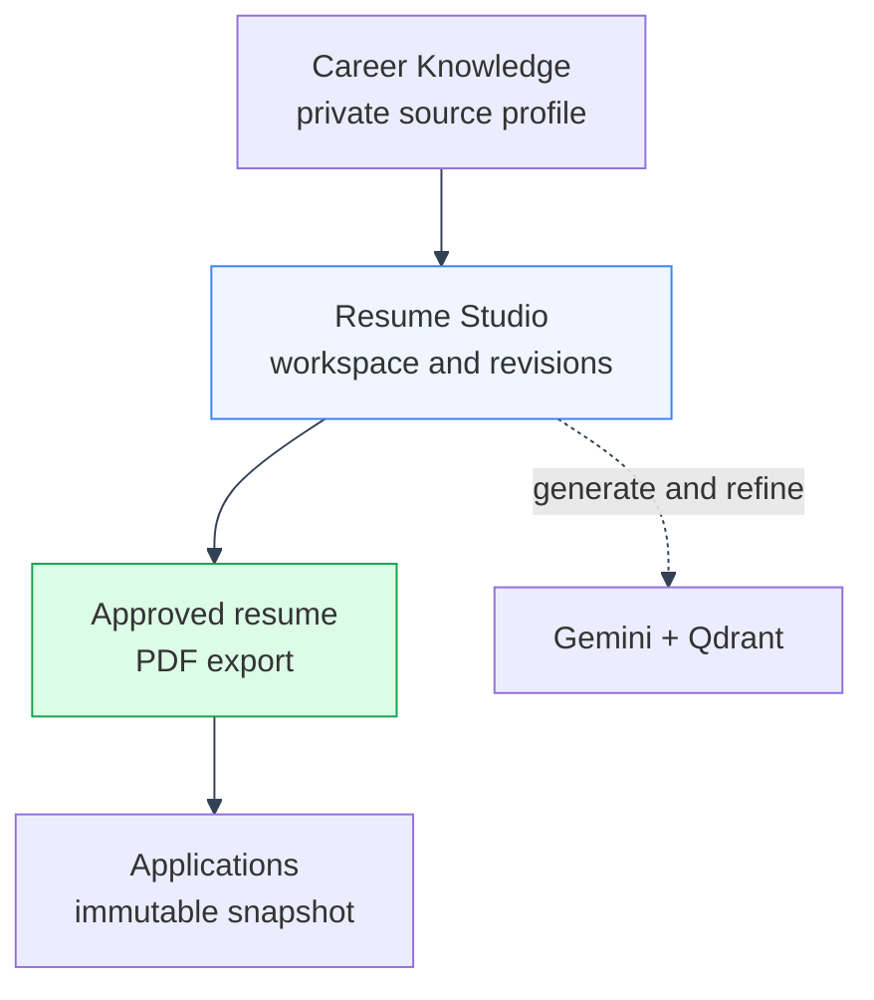

# Documentation

Documentation for ManifestCV, organized by feature/domain to mirror the actual code layout (`backend/app/<domain>/` + `backend/mystic_auth/<domain>/`, `frontend/src/app/<domain>/` + `frontend/src/mystic_auth/<domain>/`). If something here disagrees with the code, the code wins, so file an issue or update the doc.

ManifestCV is built on [mystic-auth](https://github.com/Nachiket-2024/mystic-auth) for identity and authorization. This doc set covers ManifestCV's own product features and how they are wired to that foundation. See [Auth & Authorization](auth/overview.md) for the boundary between the two, and the [Mystic Auth foundation](#mystic-auth-foundation) section below for the identity, session, and authorization documentation mirrored locally under [`docs/mystic_auth/`](../mystic_auth/README.md).

---

See [Auth & Authorization](auth/overview.md) for the `app/` versus `mystic_auth/`
boundary and the SDK surfaces used by ManifestCV. See
[System Architecture](architecture/system-overview.md) for the product component
map and request lifecycle.

---

## Setup with an AI coding agent

Use the [ManifestCV setup prompt](../../agent-prompts/app/manifestcv-setup.md)
when an AI coding agent is configuring this existing repository. It defines the
runtime environment steps, Docker verification, product smoke checks, secret
handling rules, and the boundary between ManifestCV-owned files and Mystic
Auth-owned files.

Do not use it as a replacement for the Mystic Auth foundation procedures. The
prompt points to the shared Mystic Auth setup instructions when those are
needed.

---

## Architecture

- [System Overview](architecture/system-overview.md): whole-stack component diagram, why the stack is split this way, request lifecycle
- [Backend Architecture](architecture/backend.md): `backend/app/` (ManifestCV) + `backend/mystic_auth/` (inherited) module layout, request pipeline, middleware
- [Frontend Architecture](architecture/frontend.md): `frontend/src/app/` (ManifestCV) + `frontend/src/mystic_auth/` (inherited) module layout, state management, routing, theming, and [translations](architecture/frontend.md#translations) (ManifestCV's own pages, in the same four languages as mystic-auth's chrome)

The pre-auth landing page at `/` is ManifestCV-owned. It may be redesigned or
translated for the product, but it must retain the shared SDK boundary, the
authenticated-user redirect to `/dashboard`, a keyboard-operable skip link to
`#main-content`, and WCAG 2.1 AA accessibility. The inherited browser checks
should assert stable landmarks and behavior, not product copy. Put landing-page
code and copy under `frontend/src/app/` and
`frontend/src/app/translations/`; do not edit shared Mystic Auth internals to
make a product landing page fit the template example.

---

## Auth & Authorization

- [Auth & Authorization](auth/overview.md). The `app/sdk.py` / `app/app_sdk.py` boundary, why it's loosely coupled, and why ManifestCV's own routes skip PBAC in favor of `user_id` scoping

---

## Mystic Auth foundation

Identity, sessions, authorization, and shared account operations are provided by Mystic Auth and mirrored locally under [`docs/mystic_auth/`](../mystic_auth/README.md) so the operational detail stays available beside the vendored code. Do not edit these directly.

- [Mystic Auth docs index](../mystic_auth/README.md). Authentication flows, OAuth2/PKCE, PBAC architecture and troubleshooting, security hardening, background workers, error monitoring, and deployment reference
- [Ownership split](../mystic_auth/template-usage/ownership-split.md). Which files belong to Mystic Auth, which belong to ManifestCV, and where the SDK boundary sits

---

## Product features

ManifestCV follows one product path from source material to a tracked application:

- [Career Knowledge](career-knowledge/overview.md). One private, AI-structured knowledge base per user. The source everything else is generated from
- [Resume Studio](resumes/overview.md). Tailored resume workspaces with templates, structured editing, revision history, and AI refinement
- [Document Generation](document-generation/overview.md). Rendering an approved structured resume into a styled PDF with the bundled compiler
- [Applications](applications/overview.md). Tracked job applications, each a self-contained snapshot of the resume actually sent
- [AI & Retrieval](ai-and-retrieval/overview.md). The Gemini (`ai_integration/`) and Qdrant (`retrieval/`) layers those features are built on

---

## Database

- [Database Design](../mystic_auth/database/design.md). Mystic-auth's own inherited schema (users, PBAC policies, audit logs)
- [ManifestCV's Own Tables](database/design.md). Career knowledge, Resume Studio workspaces and revisions, and application snapshots

---

## API

- [API Reference](api/reference.md). ManifestCV's own route inventory, request/response shapes, and a pointer to mystic-auth's own reference (mirrored at [`docs/mystic_auth/api/reference.md`](../mystic_auth/api/reference.md)) for the inherited routes

---

## Testing

- [Testing Overview](testing/overview.md). Backend pytest suites (inherited `tests/backend/mystic_auth/` + `tests/backend/app/`), frontend vitest suites (inherited `tests/frontend/mystic_auth/` + `tests/frontend/app/`), how to run both

---

## Docker

- [Docker Overview](docker/overview.md). Services (including `qdrant`, and `bugsink`, which starts by default), Dockerfiles (including the `tectonic` install), dev vs. Prod compose, healthchecks, validation results

---

## CI/CD

- [CI/CD Overview](cicd/overview.md). GitHub Actions workflow, jobs, what's covered and what isn't

---

## Deployment

- [Deployment Guide](deployment/guide.md). Dev vs. Prod topology, environment variables, free/low-cost hosting options for every piece including Gemini and Qdrant

---

## Concerns, Limitations & Technical Debt

- [Known Issues & Future Improvements](concerns/README.md). Tracked, *unresolved* limitations only. Anything already fixed lives in the relevant feature doc instead, not here

---

## Who this is for

Anyone adding a new ManifestCV feature, integrating a new frontend page against the API, debugging why an AI/retrieval call or a request came back the way it did, or new to the codebase and wanting the system-wide picture before touching product code. For anything about the underlying auth/PBAC layer itself, start at [Auth & Authorization](auth/overview.md) and follow its links into [`docs/mystic_auth/`](../mystic_auth/README.md).

---

## Source of truth

This documentation describes the code as it exists in `backend/app/`/`backend/mystic_auth/` and `frontend/src/app/`/`frontend/src/mystic_auth/` at the time of writing. If something here disagrees with the code, the code wins.

---
