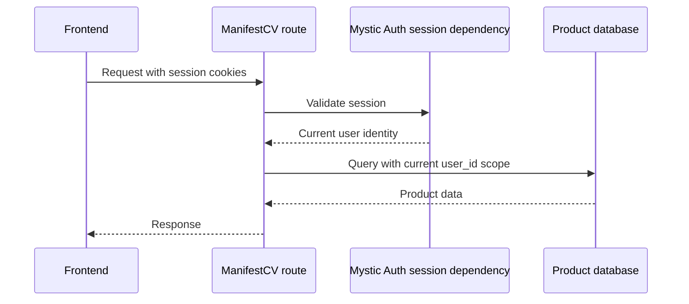

# API Reference

---

ManifestCV's app owned routes are mounted from `backend/app/main.py`. Every route requires a valid session and scopes product data to the current user. Mystic Auth routes are documented separately in [`docs/mystic_auth/api/reference.md`](../../mystic_auth/api/reference.md).

## Career Knowledge

---

The `/career-knowledge` routes manage the private source material used by Resume Studio.

| Method | Path | Purpose |
|---|---|---|
| POST | `/career-knowledge/` | Create and index the user's knowledge base |
| GET | `/career-knowledge/` | Read the user's knowledge base |
| PUT | `/career-knowledge/` | Edit and reindex the knowledge base |
| DELETE | `/career-knowledge/` | Remove the knowledge base and its index |
| GET | `/career-knowledge/search` | Search indexed knowledge for a query |

## Resume Studio

---

The `/resume-workspaces` routes are the active resume product API. The frontend uses them through `frontend/src/app/api/resume_builder_api.ts`.

| Method | Path | Purpose |
|---|---|---|
| GET | `/resume-workspaces/templates` | List available layouts |
| GET | `/resume-workspaces/templates/{template_key}` | Read a layout and its document structure |
| POST | `/resume-workspaces` | Create a workspace from a title, job description, and template |
| GET | `/resume-workspaces` | List the user's workspaces |
| GET | `/resume-workspaces/{workspace_id}` | Read a workspace and its current revision |
| DELETE | `/resume-workspaces/{workspace_id}` | Delete a workspace and its revisions |
| PUT | `/resume-workspaces/{workspace_id}/document` | Save a structured document revision |
| POST | `/resume-workspaces/{workspace_id}/generate` | Generate tailored content from Career Knowledge |
| POST | `/resume-workspaces/{workspace_id}/refine` | Apply an AI refinement and save a revision |
| POST | `/resume-workspaces/{workspace_id}/refine/preview` | Preview an AI refinement without saving |
| GET | `/resume-workspaces/{workspace_id}/revisions` | List saved revisions |
| POST | `/resume-workspaces/{workspace_id}/revisions/{revision_id}/restore` | Restore a previous revision |
| POST | `/resume-workspaces/{workspace_id}/approve` | Lock the workspace for export and application tracking |
| GET | `/resume-workspaces/{workspace_id}/preview` | Render a workspace preview |
| POST | `/resume-workspaces/{workspace_id}/generate-job` | Queue background content generation |
| POST | `/resume-workspaces/{workspace_id}/export-job` | Queue background PDF export |
| GET | `/resume-workspaces/{workspace_id}/export` | Download an exported PDF |
| GET | `/resume-jobs/{job_id}` | Read a background job status |
| GET | `/resume-jobs/{job_id}/download` | Download a completed export job |

## Applications

---

The `/applications` routes track opportunities and store an immutable snapshot of the approved Resume Studio document used for each application.

| Method | Path | Purpose |
|---|---|---|
| POST | `/applications/` | Create an application from an approved workspace |
| GET | `/applications/` | List application records |
| GET | `/applications/{application_id}` | Read an application and its snapshot |
| GET | `/applications/{application_id}/pdf` | Download the stored PDF snapshot |
| PATCH | `/applications/{application_id}` | Update tracking fields |
| DELETE | `/applications/{application_id}` | Delete an application record |

## Errors and authentication

The API uses the shared cookie based session from Mystic Auth. App owned resources are ownership scoped and do not require PBAC permissions. Invalid payloads return `422`; missing or inaccessible resources return `404`; generation and export failures return an appropriate service error. Error responses use the shared application error shape so the frontend can translate known codes.
