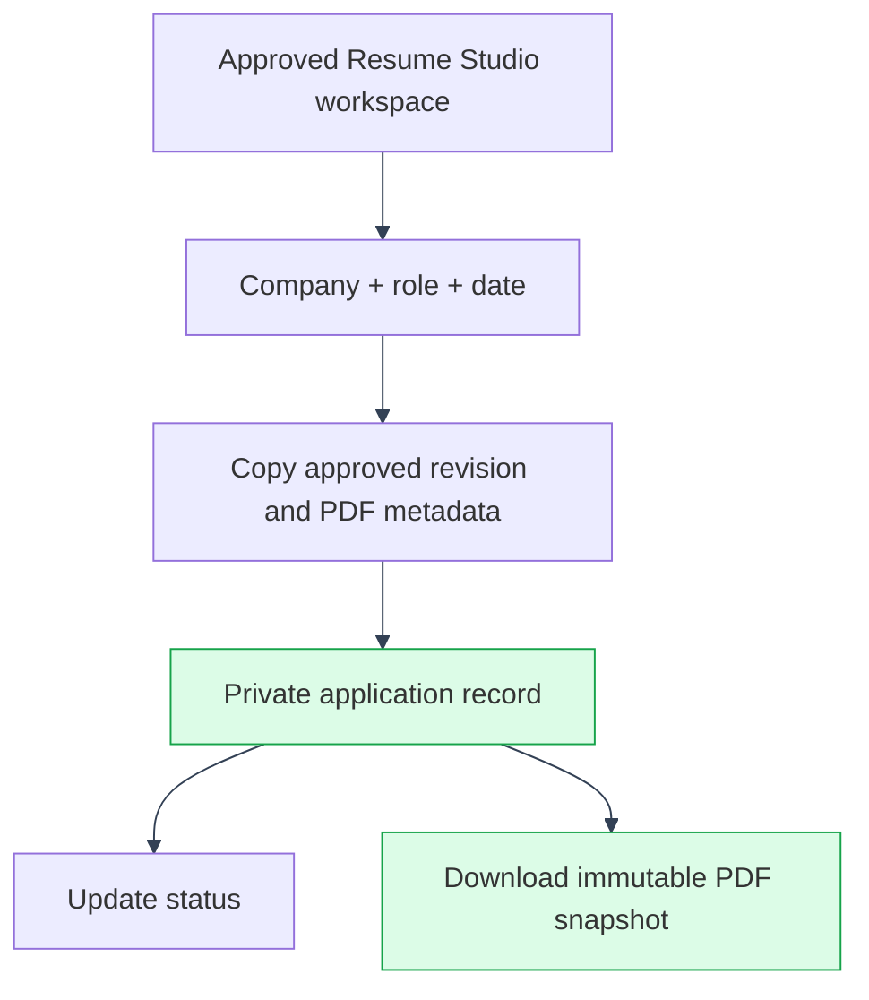

# Applications

---

Applications tracks the opportunities connected to a user's Resume Studio workspaces. Each record preserves the approved resume document and export details used at the time it was created.

## Data model

---

`ApplicationRecord` stores the company, role, application date, status, workspace reference, revision reference, document snapshot, and PDF snapshot metadata. The copied snapshot remains stable when the source workspace is later edited.

Supported statuses are `applied`, `interviewing`, `offered`, and `rejected`.

## Flow

---

The application record is a snapshot, not a live view of the workspace. Later resume edits do not change what was tracked for that application.

---

1. Approve a Resume Studio workspace.
2. Enter company and role details in the Application snapshot panel.
3. Create the application record.
4. Update tracking fields as the opportunity progresses.
5. Download the stored PDF snapshot when needed.

## API

---

The frontend uses `frontend/src/app/api/application_api.ts`. The backend routes are listed in the [API Reference](../api/reference.md#applications). Application data is private to the signed in user and does not use PBAC permissions.
