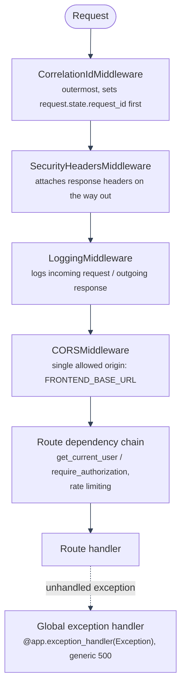

# Backend Architecture

---

## Purpose

FastAPI application (`backend/`), async throughout. SQLAlchemy async engine, async Valkey client, async SMTP, async Qdrant client. One codebase, three container roles (`backend`, `procrastinate_worker`, `alembic`) built from the same image with different `command:` overrides. See [Docker Overview](../docker/overview.md).

The app is two layers, kept in physically separate top-level Python packages: an identity and authorization foundation vendored from mystic-auth (`backend/mystic_auth/`) and ManifestCV's own product domains built on top of it (`backend/app/`: Career Knowledge, Resume Studio, Applications, AI integration, retrieval, storage, and export).

The only bridge between the two is `backend/app/sdk.py`, this repo's own copy of mystic-auth's extension-surface convention, re-exporting mystic-auth's internals (`get_current_user`, `require_authorization`, `database`, `settings`, `rate_limiter_service`, etc.) for `backend/app/`'s own code to import, plus `backend/app/app_sdk.py`, ManifestCV's own small id-resolution helper, kept in a separate file from `sdk.py` specifically so a template update never conflicts with something ManifestCV added. See [Auth & Authorization](../auth/overview.md).

Because they're sibling top-level packages rather than one nested under the other, a plain absolute `mystic_auth.*` import would only resolve inside the Docker image (`WORKDIR /app`), not from the repo root the test suite runs from. `sdk.py` is the one file that crosses the boundary, and it does so via an `importlib`-based helper that derives the correct prefix (`mystic_auth` under Docker, `backend.mystic_auth` from the repo root) from its own `__package__` at runtime. Everything else, within either package, stays relative exactly as before the split.

---

## Module layout

### `backend/mystic_auth/`: inherited from mystic-auth

| Module | Purpose |
|---|---|
| `api/auth_routes/`, `api/user_routes/`, `api/pbac_routes/`, `api/audit_log_routes/`, `api/health_routes/` | Route registration only. One `APIRouter` per feature, no business logic |
| `auth/` | Authentication: signup, login, logout, logout-all, refresh-token rotation, password reset, account verification, Google OAuth2/PKCE, JWT/cookie handling, security middleware/rate limiting (`auth/security/`) |
| `authorization/` | PBAC engine: policies, conditions, evaluator, caching, its own audit log |
| `audit_log/` | Security/session-event audit log (`security_audit_log` table). Distinct from the PBAC audit log |
| `core/` | Cross-cutting config: `settings.py` (pydantic-settings, env-driven). Extended with ManifestCV's own AI/retrieval settings, see below |
| `database/` | `connection.py`: async SQLAlchemy engine/session factory. `base.py`: declarative base |
| `emails/` | HTML email template rendering, SMTP transport, address normalization. Used by the Procrastinate email task |
| `logging/` | Structured, module-scoped loggers. Correlation-ID and request/response logging middleware |
| `valkey/` | Single async Valkey client, shared by rate limiting, lockout, caching, and token registries |
| `scripts/` | `create_system_user.py`: one-off interactive CLI to bootstrap the reserved system account |
| `procrastinate_tasks/` | The Postgres-native task app (`procrastinate_app.py`), plus the email-sending, daily account-purge, and audit-log tasks it runs. See [Background Email Delivery](../../mystic_auth/background-workers/procrastinate.md) |
| `user_crud/`, `user_table/` | CRUD orchestration and SQLAlchemy model/schema for the `users` table |
| `error_monitoring/` | `sentry_service.py`: optional, disabled unless `SENTRY_DSN` is set. A no-op otherwise. See [Error Monitoring](../../mystic_auth/error-monitoring/overview.md) |

Unlike a standalone Mystic Auth installation (where `sdk.py`/`app_sdk.py` live inside `mystic_auth/` itself), this repo keeps Mystic Auth's own package free of any ManifestCV extension file. See `backend/app/`'s own `sdk.py`/`app_sdk.py` below. For how any of these modules actually work internally, see [mystic-auth's own docs](https://github.com/Nachiket-2024/mystic-auth/tree/main/docs/mystic_auth). This repo doesn't duplicate that documentation, only what ManifestCV adds on top of it or depends on from it.

### `backend/app/`: ManifestCV's own domains

| Module | Purpose |
|---|---|
| `sdk.py` | The public extension surface for `backend/app/`'s own code. Re-exports mystic-auth's internals (`get_current_user`, `require_authorization`, `Permission`, `database`, `settings`, `capture_exception`, `rate_limiter_service`, routers, middleware, etc.) so ManifestCV's route modules import from `app.sdk` rather than reaching into `mystic_auth`'s internal paths directly. See [Auth & Authorization](../auth/overview.md) |
| `app_sdk.py` | ManifestCV's own id-resolution helper (`get_user_id_by_email`). The counterpart to `sdk.py`, for glue mystic-auth has no reason to provide, kept in its own file so a template update to `sdk.py` never conflicts with it. See [Auth & Authorization](../auth/overview.md) |
| `career_knowledge_table/`, `career_knowledge_crud/`, `api/career_knowledge_routes/` | One knowledge base per user. See [Career Knowledge](../career-knowledge/overview.md) |
| `resume_builder/`, `api/resume_builder_routes/` | Resume Studio workspaces, structured documents, templates, revisions, generation, refinement, approval, and export. See [Resume Studio](../resumes/overview.md) |
| `storage/`, `document_generation/` | Object storage and document export services used by Resume Studio. See [Document Generation](../document-generation/overview.md) |
| `application_table/`, `application_crud/`, `api/application_routes/` | Tracked job applications. See [Applications](../applications/overview.md) |
| `ai_integration/`, `retrieval/` | Gemini text generation/embeddings and Qdrant vector search. See [AI & Retrieval](../ai-and-retrieval/overview.md) |
| `main.py` | App entrypoint: middleware registration, router mounting (Mystic Auth's routers plus ManifestCV's Career Knowledge, Resume Studio, export jobs, and Applications routers), global exception handler, lifespan (Qdrant collection bootstrap on startup, DB pool / Valkey / Qdrant client cleanup on shutdown). Stays under `app/` and remains the `uvicorn app.main:app` / `backend.app.main:app` entrypoint everywhere, since it is the composition root that mounts both packages' routers together |

`main.py` keeps the boundary explicit: upstream primitives come through `app/sdk.py`, while ManifestCV-only settings come from `app/app_settings.py` and app-owned glue comes from `app/app_sdk.py`. The app code does not modify or import upstream implementation files directly.

---

## Request pipeline

Starlette applies middleware in reverse of add order, which is why `CorrelationIdMiddleware` is added *last* in `main.py` to end up *outermost*. See the inline comment there for the exact reasoning.

In production (`ENVIRONMENT=production`), `/docs`, `/redoc`, and `/openapi.json` are disabled entirely (`main.py`). One less surface to lock down at a reverse proxy.

---

## Configuration

Upstream authentication configuration remains centralized in `mystic_auth/core/settings.py`. ManifestCV-only settings are layered in `backend/app/app_settings.py`, which loads the matching `env/mystic_auth/.env.dev` and `env/app/.env.dev` files and exposes `GEMINI_API_KEY`, `GEMINI_MODEL`, `GEMINI_EMBEDDING_MODEL`, and `QDRANT_URL`. See both env example files for the two configuration surfaces.

---

## Database layer

SQLAlchemy 2.0, fully async (`asyncpg` driver). `mystic_auth/database/connection.py`'s `Database` class wraps the async engine and session factory. A module-level `database` singleton is imported everywhere a session is needed (`Depends(database.get_session)`). Schema is managed entirely through Alembic migrations (`backend/alembic/versions/`). No `create_all()` anywhere in application startup. ManifestCV's active tables chain directly after mystic-auth's own migration history rather than branching. See [ManifestCV's Own Tables: Migrations](../database/design.md#migrations).

---

## Error handling

Two layers:

1. **Expected failures**: routes/services raise `HTTPException` with a specific status code and `detail`. ManifestCV's AI-backed routes (Career Knowledge and Resume Studio) additionally translate `AIIntegrationError` into `502 Bad Gateway`, since that's a failure of an upstream dependency (Gemini), not the caller's request.
2. **Unexpected failures**: `main.py`'s global exception handler catches anything that escapes the first layer, logs the full traceback, and returns a generic `500` with no internal detail.

---

## Logging

Structured, module-scoped loggers via `mystic_auth/logging/logging_config.py::get_logger(__name__)` throughout. Every request gets a correlation ID (`CorrelationIdMiddleware`) attached to every log line emitted while handling it, making it possible to grep `docker compose logs backend` for one request's full trail.

---

## Testing coverage

`tests/backend/mystic_auth/{unit,integration,security,performance}/` cover the inherited mystic-auth foundation (`backend/mystic_auth/`). `tests/backend/app/{unit,integration}/` cover ManifestCV's own domains (`backend/app/`). Resume Studio tests cover workspace ownership, structured documents, revisions, and export jobs. See [Testing Overview](../testing/overview.md).
