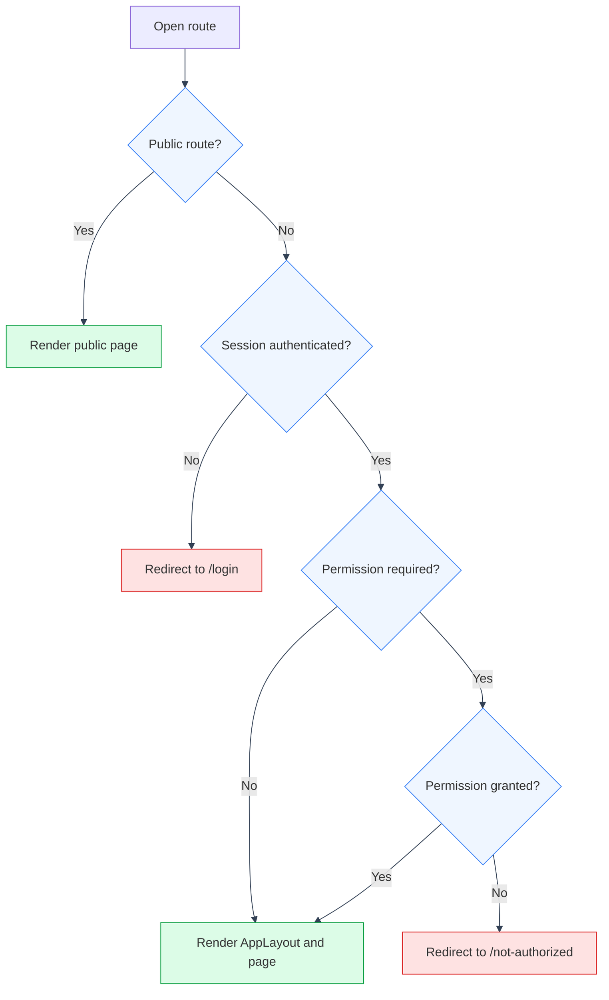

# Frontend Architecture

---

## Purpose

React 19 + TypeScript SPA (`frontend/src/`), built with Vite. Mystic Auth's inherited UI and ManifestCV's feature pages use Tailwind, shadcn, and Radix. ManifestCV's own domains (`career_knowledge/`, `resume_builder/`, `applications/`, plus `api/` and `ui/`) live under `frontend/src/app/`, alongside the app shell (`App.tsx`, `main.tsx`, `sdk.ts`, `app_sdk.ts`). They use app owned SDK surfaces rather than reaching into Mystic Auth internals directly. See [Auth & Authorization](../auth/overview.md).

---

## Module layout

### `frontend/src/mystic_auth/`: inherited from mystic-auth

| Module | Purpose |
|---|---|
| `auth/` | Login, signup, logout, logout-all, OAuth2, password reset (request/confirm), account verification, current-user session query, the auth-refresh interceptor (`setupAuthInterceptor.ts`). Each sub-feature is its own folder (Page/Form/mutation-hook/types). `password_rules/` holds password-complexity validation (`passwordRules.ts`) and its checklist UI, shared by signup/reset/account settings |
| `authorization/` | The PBAC layer: `permissions.ts` (frontend mirror of the backend `Permission` enum), `authorizationService.ts` (batch permission-check calls, policy/audit-log fetches), `useAuthorization`/`useCan`, and the gate components `Authorized`, `IfCan`, `ProtectedRoute` |
| `audit_log/` | `AuditLogPage.tsx`: the caller's own PBAC audit trail, plus an "all users" tab for privileged callers |
| `dashboard/` | Landing page after login |
| `policies/` | Admin CRUD UI for PBAC policies |
| `account_settings/` | Self-service account view/update, plus `useUnsavedChangesWarning` (also used by ManifestCV's resume editor, see below) |
| `users/` | Admin user management (list, mutate, assign policies) |
| `store/` | Zustand: `authStore.ts` (session/account/permissions), `themeStore.ts` (light/dark). Client state only, no Redux |
| `core/` | `queryClient.ts` (the shared TanStack Query client, also used by ManifestCV's own query hooks), `settings.ts` (`APP_NAME`, `VITE_API_BASE_URL`, etc., read through `import.meta.env`), and `errorMonitoring.ts` (optional, disabled unless `VITE_SENTRY_DSN` is set, see [Error Monitoring](../../mystic_auth/error-monitoring/overview.md)). ManifestCV reads all of these through `app/sdk.ts` rather than its own copy, see below |
| `layout/` | App shell: `AppLayout`, `Navbar`, `Sidebar`, `ThemeToggle`, `navItems.ts` (unmodified, see below) |
| `api/` | `axiosInstance.ts`, `apiError.ts`, plus mystic-auth's own per-domain typed call functions (`auth_api`, `users_api`, `account_settings_api`, `policies_api`, `audit_api`) |
| `ui/` | Generic reusable UI kit, no feature ownership: `DataTable`, `ConfirmDialog`, `FormAlert`, `PageContainer`, `Card`, `LoadingState`, `toaster`/`toasterInstance`, `ErrorBoundary`. ManifestCV's own pages reuse these directly, through `app/sdk.ts` |
| `theme.ts` | ManifestCV-owned theme override contract. The inherited design system is MysticAuth's Tailwind/CSS-variable theme. |

`frontend/src/mystic_auth/` has no `sdk.ts` of its own in this repo. Unlike a standalone Mystic Auth installation (where `sdk.ts`/`app_sdk.ts` live inside `mystic_auth/` itself), the extension-surface files live in `frontend/src/app/` instead, described next.

`layout/navItems.ts` (single source of truth for the sidebar's built in link list) stays byte identical to the vendored file. ManifestCV's own sidebar links (`/career-knowledge`, `/resume-builder`, `/applications`) are added via `AppLayout`'s `extraNavItems` prop instead, with app owned Lucide icons. Passed from `App.tsx`, ordered to land right after Dashboard.

### `frontend/src/app/`: the app shell and ManifestCV's own domains

| Module | Purpose |
|---|---|
| `sdk.ts` | Upstream-owned, never hand-edited. The public extension surface for `frontend/src/app/`'s own code. Re-exports mystic-auth's pieces (`PERMISSIONS`, `useAuthorization`, `useCan`, `Authorized`, `IfCan`, `ProtectedRoute`, `authorizationService`, `AppLayout`/`NavItem`, `Toaster`/`toaster`, `LoadingState`/`Card`/`PageContainer`/`DataTable`/`ConfirmDialog`/`FormAlert`/`ErrorBoundary`, `api`, `extractApiErrorMessage`, `useAuthStore`, `queryClient`, `settings`/`APP_NAME`, `reportError`) so ManifestCV's own domain code never reaches into `mystic_auth/`'s internal paths directly. See [Auth & Authorization](../auth/overview.md) |
| `app_sdk.ts` | ManifestCV's own extension surface. The counterpart to `sdk.ts`, kept in its own file so a template update to `sdk.ts` never conflicts with anything ManifestCV adds here. Re-exports `useUnsavedChangesWarning`, the shared UI primitives (`PageContainer`, `Card`, `DataTable`, `ConfirmDialog`, `FormAlert`, `LoadingState`, `TableActionButton`, `StyledSelect`, `toaster`), the button-hover style objects (`BRAND_SOLID_HOVER_PROPS`, `SECONDARY_BUTTON_PROPS`), and the shared `translations` (i18next) instance - all imported directly from `mystic_auth/`, not through `sdk.ts`, since `sdk.ts` deliberately doesn't carry these (see [Auth & Authorization](../auth/overview.md)) |
| `App.tsx`, `main.tsx` | Routing (below) and the app's React entry point |
| `career_knowledge/` | `CareerKnowledgePage.tsx` + query/mutation hooks. The caller's own knowledge base. See [Career Knowledge](../career-knowledge/overview.md) |
| `resume_builder/` | Resume Studio workspaces, setup, template selection, document canvas, revisions, AI refinement, and export. See [Resume Studio](../resumes/overview.md) |
| `applications/` | `ApplicationsPage.tsx` + query/mutation hooks. Tracked applications. See [Applications](../applications/overview.md) |
| `api/application_api.ts`, `api/career_knowledge_api.ts`, `api/resume_builder_api.ts` | Axios-based typed call functions for ManifestCV's feature route groups. A ManifestCV-owned `api/` folder, sibling to mystic-auth's own `mystic_auth/api/` |
| `ui/Pager.tsx` | Offset-pagination Previous/Next control used by app owned list pages. No identity concept, so it lives in ManifestCV's own `ui/` |
| `translations/` | ManifestCV's own translation namespaces (`app_common`, `career_knowledge`, `resumes`, `applications`), English/Hindi/Marathi/Gujarati, registered onto mystic-auth's shared i18next instance. See [Translations](#translations) below |

This layout deliberately mirrors the backend's own domain split (`backend/mystic_auth/auth/`, `backend/mystic_auth/authorization/`, `backend/mystic_auth/core/`, etc.) rather than a layer-first (`components/`/`hooks`/`services`) MVC structure. A file's folder tells you which backend domain it serves, not what kind of file it is. `api/`, `store/`, `core/`, `layout/`, `ui/`, and `theme/` are the exceptions: infrastructure/cross-cutting concerns with no single feature owner, kept as their own top-level folders (split between `mystic_auth/` and `app/` the same way the rest of the tree is) rather than scattered into every feature that touches them.

---

## State management

- **Zustand** for client state. `mystic_auth/store/authStore.ts` (`isAuthenticated`, `name`, `email`, `role`, `permissions`, `hasPassword`) and `mystic_auth/store/themeStore.ts` (light/dark). No Redux.
- **TanStack Query** for all server state/caching, via one shared `QueryClient` (`mystic_auth/core/queryClient.ts`, re-exported from `app/sdk.ts`).
- `authStore.isAuthenticated` starts as `null` ("not checked yet"). `App.tsx` blocks rendering the router behind a loading screen until `useAuthSession()` resolves it to `true`/`false`, avoiding a flash of unauthenticated content.

---

## API layer

`mystic_auth/api/axiosInstance.ts` is a single Axios instance, `withCredentials: true` (cookie-based session, the JWT itself is never stored in JS-accessible state), base URL from `VITE_API_BASE_URL`. Mystic-auth's own per-domain typed call functions live in `mystic_auth/api/*.ts` (`auth_api`, `users_api`, `account_settings_api`, `policies_api`, `audit_api`). ManifestCV's own live in `app/api/*.ts` (`application_api`, `career_knowledge_api`, `resume_builder_api`, `application_api`), importing the shared `api` instance from `../sdk` rather than `../mystic_auth/api/axiosInstance` directly. `mystic_auth/api/apiError.ts` shapes error responses uniformly.

`mystic_auth/auth/setupAuthInterceptor.ts` implements silent-refresh-on-401: a single in-flight refresh call is shared across concurrently-failing requests (no thundering herd of refresh calls), and login/signup/refresh/logout/reset/verify/oauth2 endpoints are excluded from the retry-after-refresh logic to avoid infinite loops. On an unrecoverable 401, it marks `authStore` unauthenticated and clears the cached `GET /auth/me` query. It does not handle `403`: permission failures are left entirely to route/component-level guards (`ProtectedRoute`, `Authorized`, `IfCan`).

---

## Routing

`react-router` v8, `BrowserRouter`, defined in `App.tsx`. Not `react-router-dom`: upstream folded `react-router-dom`'s exports into `react-router` for v8. ManifestCV's Resume Studio route modules and integration tests import from `react-router` accordingly. Only `LoginPage` is eager-loaded (the most common unauthenticated entry point); every other route is `React.lazy`-split.

| Route | Access | Notes |
|---|---|---|
| `/` | public; signed-in users go to `/dashboard` | ManifestCV-owned pre-auth landing page |
| `/dashboard` | authenticated | `DashboardPage` |
| `/users` | `USERS_LIST_ALL` | Admin user management |
| `/policies` | `POLICIES_READ` | PBAC policy admin |
| `/audit-log` | authenticated (self-service) | "All users" tab gated separately inside the page |
| `/account-settings` | authenticated | |
| `/career-knowledge` | authenticated (self-service) | ManifestCV; no permission required, ownership is server-side |
| `/resume-builder`, `/resume-builder/new`, `/resume-builder/new/templates`, `/resume-builder/:workspaceId` | authenticated (self-service) | ManifestCV. Resume Studio workspace list, setup, template selection, and editor |
| `/applications` | authenticated (self-service) | ManifestCV. Tracked applications |
| `/login`, `/signup`, `/verify-account`, `/password-reset-request`, `/reset-password` | public | |
| `/not-authorized` | public | 403 landing. Where `ProtectedRoute` sends an authenticated-but-unauthorized user |
| `*` | public | 404 |

All protected routes are wrapped in `ProtectedRoute` (redirects unauthenticated users to `/login` and unauthorized users to `/not-authorized`) and `AppLayout` (sidebar/top-bar shell), so the shell only renders once access is actually confirmed.

The app root waits for the current-session check before rendering routes. The
ManifestCV-owned landing page is then available at `/`; it redirects signed-in
users to `/dashboard` and shows product content to signed-out visitors.

---

## Authorization on the frontend (PBAC-aware UI)

- `mystic_auth/authorization/permissions.ts` mirrors the backend's `Permission` enum as string constants, so route/component gates reference `PERMISSIONS.USERS_LIST_ALL` rather than a hand-typed string.
- `mystic_auth/authorization/useAuthorization.ts` reads `authStore.permissions` and exposes `can(action)`, failing closed (`false`) when unauthenticated or still loading. This is a **client-side UX convenience only**: the backend independently enforces every action via `require_authorization`. A hidden button is not a security boundary.
- `mystic_auth/authorization/ProtectedRoute.tsx`, `Authorized.tsx`, `IfCan.tsx`: route-level and in-page conditional gates built on `useAuthorization`.
- `mystic_auth/authorization/authorizationService.ts` layers real per-resource/conditional checks (`POST /authorization/batch-check`) on top of the cached flat permission list for cases that need it.
- `role` is explicitly treated as metadata only on the frontend too. Never used in a gating decision, mirroring the backend's own design.
- ManifestCV's own routes (`/career-knowledge`, `/resume-builder`, `/applications`) deliberately carry no `permission` prop. They are self service, ownership scoped resources, not PBAC gated ones. See [Auth & Authorization](../auth/overview.md).

---

## Translations

mystic-auth ships its own multi-language support (English/Hindi/Marathi/Gujarati, plus three "chrome in English, content translated" mixed modes - see [Translations Overview](../../mystic_auth/translations/overview/README.md)) for its own pages (`mystic_auth/translations/`, an upstream-owned file tree). ManifestCV's own pages (Career Knowledge, Resume Studio, Applications, the sidebar labels, and the pager) are translated too, in the same four languages, using the same `react-i18next` instance. They are registered from ManifestCV's own extension surface rather than by editing anything under `mystic_auth/`:

- `frontend/src/app/translations/translations.ts` imports the four languages' JSON for four namespaces (`app_common`, `career_knowledge`, `resumes`, `applications`) and calls i18next's own `addResourceBundle(lang, namespace, resource, true, true)` for each, using the shared `translations` instance re-exported from `app_sdk.ts` (see the module table above). This is a plain library call, not a hand-edit of any vendored file: `mystic_auth/translations/translations.ts` (which actually calls `init()`) is never touched.
- `frontend/src/app/translations/languages/<lang>/<namespace>.json` holds the four namespaces' strings, one file per language per namespace, mirroring mystic-auth's own `languages/<lang>/<namespace>.json` layout and key-naming style.
- A small fifth file, `errors.json`, merges ManifestCV's own `AppError` codes (`APPLICATION_NOT_FOUND` and `CAREER_KNOWLEDGE_BASE_NOT_FOUND`, plus Resume Studio workspace errors) into mystic-auth's existing `errors` namespace. The shared error helper resolves these codes consistently for app owned pages.
- `frontend/src/app/main.tsx` imports `./translations/translations.ts` once, eagerly, right after `mystic_auth/store/languageStore.ts` (which is what actually calls i18next's `init()` - `addResourceBundle` needs an already-initialized instance). Component code just calls `useTranslation("resumes")` etc., the normal `react-i18next` way, same as mystic-auth's own pages.
- Tests get the same treatment: `frontend/src/app/__tests__/setup.ts` imports the same module, and is listed in `vitest.config.ts`'s `setupFiles` after mystic-auth's own `mystic_auth/__tests__/setup.ts`, so `useTranslation()` in a ManifestCV component test renders real English text instead of a raw key like `"pager.next"`.

Adding a language to mystic-auth's own set (see its own [tutorial](../../mystic_auth/translations/overview/README.md#tutorial-adding-a-new-language)) automatically covers ManifestCV's chrome (navbar, sidebar, dates) once mystic-auth is synced; ManifestCV's own four namespaces need the matching new-language JSON file added under `translations/languages/<lang>/` and registered in `translations.ts`'s per-language resource maps, the same shape as the existing `en`/`hi`/`mr`/`gu` entries.

---

## Theming

The inherited UI uses Tailwind/CSS variables and Radix primitives. ManifestCV pages consume those same shared primitives through `app/sdk.ts`; `app/ui/AppStyledSelect.tsx` remains a small app-owned adapter for app-specific call sites. `mystic_auth/store/themeStore.ts` and the inherited controls handle light/dark switching; `app/theme.ts` is reserved for app-owned CSS-variable overrides.

---

## Build & bundling

`vite.config.ts` has no custom `build.rollupOptions.output.manualChunks`. An earlier revision forced every `node_modules` import into one `vendor` chunk for better long-term browser caching (rarely-changing third-party code under a stable content hash, separate from app code that changes every deploy), but that broke production: app files like `api/axiosInstance.ts` both import from and get imported by that vendor chunk, and Rollup placed shared CJS-interop helpers into `axiosInstance`'s own chunk, creating a real circular chunk dependency. ESM's live-binding semantics for circular imports meant `vendor.js` called a binding from `axiosInstance.js`'s chunk before that chunk's module body had run far enough to define it, throwing `TypeError: t is not a function` at the very top of the vendor bundle. The whole app failed to mount: a blank page with no build-time warning. Reverted to Rollup's own automatic chunking (its default module-graph analysis doesn't create this circular dependency). Re-introduce manual chunking later only with real production verification (not just curling the built files) that nothing crashes.

- Route-level code splitting is unaffected by the above and already in place. See [Routing](#routing) above: every route except `LoginPage` is `React.lazy`-loaded, so route chunks only ever contain that page's own code plus the shared primitives it specifically imports.
- App pages use the inherited Tailwind/CSS-variable/Radix primitives directly or through `app/sdk.ts`. There is no app-owned UI compatibility dependency layer.

---

## Configuration requirements

Root `.env.example`: `VITE_API_BASE_URL` (the backend's base URL), `VITE_APP_NAME` (the product name shown in the UI: navbar, auth pages, document title via `index.html`'s `%VITE_APP_NAME%` substitution), and the optional `VITE_SENTRY_DSN`/`VITE_SENTRY_ENVIRONMENT` pair (see [Error Monitoring](../../mystic_auth/error-monitoring/overview.md)). All are Vite build-time env vars, read through `core/settings.ts`/`mystic_auth/core/errorMonitoring.ts`. `vite.config.ts`'s `envDir: '..'` is what points the dev server at the repo root instead of `frontend/` for these, giving one `.env` for both the dev server and the production build (whose build args come from the same file via Compose interpolation, not a separate `frontend/.env`). Support email shown in emails is backend-driven (`SUPPORT_EMAIL`) and only ever appears in server-rendered email templates, not in the frontend build.

---

## Edge cases / error handling

- A 401 mid-session (expired access token) triggers one silent refresh-and-retry. A second failure marks the session invalid and, per route, redirects to `/login`.
- A 403 (authorization denial) is a normal API response the calling component/page is responsible for handling. Typically a toast or an inline `FormAlert`, not a global redirect (except at the route level via `ProtectedRoute`).
- An uncaught render-time error anywhere in the tree is caught by `mystic_auth/ui/ErrorBoundary.tsx`, mounted once at the app root in `main.tsx` (outside the router, so it also catches an error thrown before routing itself renders). Shows a "Something went wrong" fallback with a full-page reload action instead of React unmounting the entire tree to a blank white screen. Always logs to the console. Also reports to `mystic_auth/core/errorMonitoring.ts` (a no-op unless `VITE_SENTRY_DSN` is set. See [Error Monitoring](../../mystic_auth/error-monitoring/overview.md)).

---

## Testing coverage

Tests live in `tests/frontend/` (outside `src/`), not co-located. Vitest + React Testing Library + jsdom + axios-mock-adapter. See [Testing Overview](../testing/overview.md) for the full breakdown and known coverage gaps.
