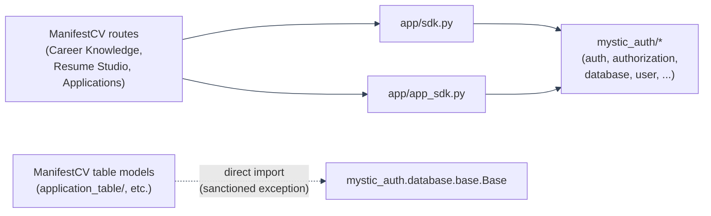

# Auth & Authorization
---

ManifestCV does not implement its own authentication or authorization. It is built on [mystic-auth](https://github.com/Nachiket-2024/mystic-auth), a full-stack identity and PBAC template, vendored in unmodified. The vendored code and ManifestCV's own product code are kept in separate top-level packages: `backend/mystic_auth/` and `frontend/src/mystic_auth/` for Mystic Auth internals, and `backend/app/` and `frontend/src/app/` for Career Knowledge, Resume Studio, Applications, and their extension surfaces. For login, signup, OAuth2, tokens, PBAC policies, or audit logging, see the Mystic Auth documentation.

What's documented here is the ManifestCV-specific part: how ManifestCV's own product code reaches into that foundation without becoming tightly coupled to it. A boundary that predates the physical folder split above and is what made that split mechanical rather than a rewrite (see [Why loose, not tight](#why-loose-not-tight)).

---

## The boundary: `backend/app/sdk.py` + `backend/app/app_sdk.py`

mystic-auth's own template convention gives the downstream product an extension surface under `app/`: `sdk.py` is upstream-maintained and exposes the template's building blocks, while `app_sdk.py` is downstream-owned and holds product-specific re-exports so it never conflicts on a sync. See its `docs/mystic_auth/template-usage/overview.md#the-app--mystic-auth-split`. ManifestCV follows this exactly: `backend/app/sdk.py` is kept as upstream's file, and `backend/app/app_sdk.py` holds every piece of mystic-auth-adjacent glue ManifestCV itself needs, both identity/id-resolution and the two pieces of generic infrastructure below. ManifestCV's feature code imports from exactly these two places, neither of which reaches into mystic-auth's internals directly:

- **`get_current_user`**: imported from `app.sdk`, which re-exports `mystic_auth.auth.current_user.current_user_dependency.get_current_user` unchanged. Every ManifestCV route depends on the exact same dependency mystic-auth's own routes use, so session/cookie/token behavior is identical everywhere. Sourcing through `app.sdk` rather than mystic-auth's internal path directly means an upstream rename only ever needs fixing in one file, not every ManifestCV route module.
- **`get_user_id_by_email`**: a small translation function ManifestCV owns itself, in `backend/app/app_sdk.py`. Mystic Auth's `get_current_user` returns a dict (`email`, `role`, `permissions`), while ManifestCV's user owned tables store a numeric `user_id`. Every owner scoped route resolves that id once per request through this function.
- **`get_logger`, `rate_limiter_service`**: also in `app_sdk.py`, not `sdk.py`. An earlier revision added both directly to `sdk.py`'s re-export list, which worked but quietly broke the one rule that file exists to enforce (see the box above): the next sync would have had to reconcile a local edit against upstream's own version of that file instead of taking it as a clean drop-in. Moved to `app_sdk.py` instead, using the same `importlib`-based direct-module-path pattern as `get_user_id_by_email` above (see `app_sdk.py`'s own source for the exact mechanism). Neither is identity-specific, but both are genuine mystic-auth internals ManifestCV's own routes need, so routing them through the *product's* extension surface rather than `sdk.py` keeps the "don't hand-edit `sdk.py`" rule intact.



No ManifestCV route imports `mystic_auth.auth.current_user`, `mystic_auth.authorization`, `mystic_auth.user`, `mystic_auth.auth.security`, or `mystic_auth.logging` directly. Only `app.sdk` and `app.app_sdk` provide the documented identity and infrastructure extension surface. Exactly one thing is imported directly instead of through either extension surface: `mystic_auth.database.base`, the declarative `Base` every ManifestCV table model subclasses. `get_logger` and `rate_limiter_service` are product infrastructure exposed from `app_sdk.py`; Resume Studio and Career Knowledge use the limiter for AI and compute-triggering routes.

Because `mystic_auth` and `app` are separate top-level Python packages, not nested (see [Backend Architecture](../architecture/backend.md)), a plain absolute `mystic_auth.*` import inside `app/sdk.py` would only resolve inside the Docker image (`WORKDIR /app`), not from the repo root the test suite runs from. `sdk.py`'s `_m()` helper resolves this at runtime instead, deriving the correct prefix (`mystic_auth` under Docker, `backend.mystic_auth` from the repo root) from its own `__package__`. Everything downstream of `sdk.py`, ManifestCV's own route modules, imports it back via ordinary relative imports within the `app` package, since `sdk.py` is now a sibling file inside their own package, not across the boundary:

```python
# The pattern every ManifestCV route follows:
from ...sdk import get_current_user, database, get_or_404
from ...app_sdk import get_user_id_by_email  # plus get_logger/rate_limiter_service where needed

@router.get("/")
async def list_my_resume_workspaces(
    current_user: dict = Depends(get_current_user),
    db: AsyncSession = Depends(database.get_session),
):
    user_id = await get_user_id_by_email(current_user["email"], db)
    ...
```

---

## Why loose, not tight

This mirrors mystic-auth's own guidance for downstream products (see its `docs/mystic_auth/template-usage/overview.md`, "Backend customization" and "PBAC usage"): a product built on the template owns its own top-level packages and mounts its own routers, importing only from the template's documented extension surface (`sdk.py` / `sdk.ts`) rather than its internals. Concretely, that buys two things:

1. **Upgrading mystic-auth stays cheap.** When the vendored code is refreshed from upstream, only `app/sdk.py` needs to be reconciled against the new internal shape (mystic-auth's own stated design goal for that file), not every route module across `career_knowledge_*`, `resume_*`, `application_*`, and `document_generation`. `app/app_sdk.py` never needs touching for an upstream update at all: it's ManifestCV's own code, not a translation layer over mystic-auth internals.
2. **No mystic-auth code is ever edited to fit ManifestCV.** Every customization ManifestCV needs (routers mounted in `app/main.py`, app-only settings in `backend/app/app_settings.py`, the downstream-owned `app_sdk.py`, cache-clearing behavior, etc.) lives in files ManifestCV owns, never inside mystic-auth's own `auth/`, `authorization/`, `user/` modules. This same discipline is what let the two trees be physically split into `mystic_auth/` and `app/` folders without touching any of mystic-auth's own logic. Every fix that split required was either a cross-package import rewrite from relative to absolute imports (since the two packages are now siblings) or an update to one of these already-documented seam files, never a change inside mystic-auth's own modules.

---

## No PBAC on ManifestCV's own routes

mystic-auth's routes are gated by `require_authorization(action, resource_type)`, its Policy-Based Access Control. ManifestCV's own routes (Career Knowledge, Resume Studio, Applications, and export) deliberately do not use it. These are self service, private per user resources. Ownership is enforced by scoping every query to the caller's own `user_id`. This is the same reasoning mystic-auth itself applies to its own self service routes.

---

## The frontend mirrors this

`frontend/src/app/career_knowledge/`, `resume_builder/`, and `applications/` never import from `mystic_auth/auth/`, `mystic_auth/authorization/`, `mystic_auth/store/authStore`, `mystic_auth/api/axiosInstance`/`mystic_auth/api/apiError`, or `mystic_auth/ui/*` directly. Identity and authorization pieces come from `frontend/src/app/sdk.ts`, the frontend counterpart to `backend/app/sdk.py` under the same upstream-owned, never-hand-edited rule. The generic UI primitives are re-exported through `frontend/src/app/app_sdk.ts`. ManifestCV's API clients take the shared axios `api` instance from `../sdk`. Session state is handled once at the app root by mystic-auth's own `useAuthSession` and `ProtectedRoute`. ManifestCV's routes use the same `ProtectedRoute` without a permission prop.
