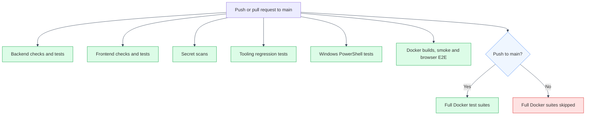

# CI/CD Overview

---

## Workflow

`.github/workflows/ci.yml`: triggers on every push and pull request targeting `main`. Seven jobs run independently. `docker-full-suite` only executes on a push to `main` (not on `pull_request`).



### `backend`: Backend (unit + integration)

- Spins up Postgres 15 and Valkey 9.1.2 as GitHub Actions **service containers** (not Docker Compose, a deliberate lower-overhead equivalent for native CI; Compose remains the source of truth for local development), pulled from the AWS ECR Public mirror rather than Docker Hub directly.
- All required settings are provided as job-level env vars with clearly-fake CI-only values, since there is no checked-in `.env` for native CI to read. `GEMINI_API_KEY` is a placeholder only. The native ManifestCV integration suite mocks every Gemini/Qdrant call at each route module's import site, so it needs no live provider; the Docker Compose smoke/full-suite jobs do start the app-owned Qdrant service.
- Installs `backend/requirements.txt` + `backend/requirements-dev.txt` (ruff, mypy, bandit: dev-only tooling, never installed into the runtime image), then runs `pip-audit -r backend/requirements.txt` (dependency vulnerability scan), `ruff check app mystic_auth alembic ../tests/backend` (lint), `mypy app mystic_auth` (type-check), and `bandit -r app mystic_auth -c pyproject.toml` (static security analysis, e.g. injection, insecure crypto, unsafe deserialization, scoped to both ManifestCV's own code and the vendored `mystic_auth/`, same as upstream's own CI) before proceeding.
- Runs `alembic upgrade head`, then `alembic check` (regression guard: fails if a model's columns/indexes have drifted from what the migrations actually create), then `pytest tests/backend/app/unit tests/backend/mystic_auth/unit`, then `pytest tests/backend/app/integration tests/backend/mystic_auth/integration --cov-append`, then `pytest tests/backend/mystic_auth/security --cov-append --cov-fail-under=90`. The `--cov-append` flags accumulate coverage across all three steps, so the 90% gate on the final step checks *cumulative* coverage across the whole run (inherited suites + ManifestCV's own), not any one suite alone. `pytest.ini` deliberately does not bake `--cov-fail-under` into `addopts` itself, since that would also apply to (and false-fail) a developer running a single suite locally. See [Testing Overview](../testing/overview.md).
- Then runs `pytest tests/backend/mystic_auth/performance` as a **non-blocking** (`continue-on-error: true`) step. Informational only, since its thresholds, while generous regression alarms rather than a strict SLA, can still be noisier on shared GitHub-hosted runners than locally.

### `frontend`: Frontend (typecheck + lint + test + build)

- Node version is pinned to `22.22.0`. React Router 8 requires Node 22.22.0 or newer, so the workflow avoids runner-default ambiguity.
- `npm ci --legacy-peer-deps`, then `npm audit --audit-level=high` (dependency vulnerability scan), then `npm run typecheck`, `npm run lint`, `npm run test:coverage` (not plain `test`: coverage must actually be collected for `vitest.config.ts`'s `coverage.thresholds` to be evaluated at all), `npm run build`, each as a separate step (so the specific failing stage is visible in the Actions UI).

### `docker-build`: Docker image build verification

- Validates all five compose files (`docker-compose.dev.yml`, `docker-compose.local-prod-{cloudflare,ngrok,tailscale}.yml`, `docker-compose.prod.yml`, all under `docker/mystic_auth/compose/`) still parse (`docker compose ... config`), using each mode's paired `env/mystic_auth/.env.*` and `env/app/.env.*` examples copied to disposable real names just to satisfy the files' `env_file` directives. No real secrets involved.
- Builds `docker/mystic_auth/dockerfiles/backend.Dockerfile` and `docker/mystic_auth/dockerfiles/frontend.Dockerfile --target production` to confirm both images still build cleanly.
- Regression guard: asserts `/app/logs` is *empty* in the built backend image (the directory itself is expected to exist: `docker/mystic_auth/dockerfiles/backend.Dockerfile` creates it at build time so a Docker-managed volume mounted there in dev inherits correct ownership, see that Dockerfile's own comment). `backend/logs/` (real request data: paths, timestamps, correlation IDs) previously leaked into the image via `COPY backend/ .`, since a bare `*.log` `.dockerignore` entry doesn't match rotated filenames like `access.log.2026-07-19`. Fixed via an explicit `backend/logs/` entry in `.dockerignore`; this step catches it coming back.
- Boots the real dev Compose stack (`postgres`, `valkey`, app-owned `qdrant`, `alembic`, `backend`, `frontend`, `procrastinate_worker`: `bugsink`/`bugsink-seed` skipped), waits for the backend to report healthy and the frontend dev server to respond, then smoke-tests both (`/health/ready` returns `"status":"ok"`, the frontend serves `<div id="root">`). This catches bad env wiring or a broken healthcheck that native jobs cannot see.
- **No push to a registry, no deploy step**: this repo has no deploy pipeline. That's an explicit scope boundary because this project does not assume a specific cloud or hosting target.

### `real-tectonic`: Real tectonic PDF compilation

- Same Postgres/Valkey service containers and the same job-level env var set as `backend` above (duplicated, not shared/templated. Kept simple over DRY for one job).
- Pre-creates `backend/logs/` on the runner, world-writable, before `docker run`: `backend/mystic_auth/logging/logging_config.py` creates that directory unconditionally at import time (no env var to redirect it, unlike `COVERAGE_FILE` below), and the checkout bind-mounted into the container is owned by the runner's user, not the image's non-root `app` user. Same root cause as the `COVERAGE_FILE` workaround just below, for a vendored module this repo doesn't hand-edit.
- Installs backend deps and runs `alembic upgrade head` directly on the runner (migrations don't need `tectonic`), then **builds `docker/mystic_auth/dockerfiles/backend.Dockerfile`** (the only place `tectonic` is installed. A bare `ubuntu-latest` runner doesn't have it) and runs the real Resume Studio export smoke tests against that image.
- `docker run --network host` reaches the Postgres/Valkey service containers via `localhost`, same as the bare-runner `backend` job. `-v "$GITHUB_WORKSPACE:/repo" -w /repo` mirrors exactly how a developer already runs this locally (`docker compose exec -w /repo backend pytest ...`: see [Docker Overview: test suite mounts](../docker/overview.md#test-suite-mounts)), not a CI-only invocation shape.
- Exists because the native backend job mocks PDF compilation at the route boundary. This job exercises the real structured-document renderer and compiler in the backend image, catching renderer or PDF compilation regressions that a mocked compile cannot. See [Document Generation](../document-generation/overview.md).

### `secrets-scan`: Secrets scan (gitleaks)

- Checks out full git history (`fetch-depth: 0`, not the default shallow clone) so a secret introduced and later removed in an earlier commit is still caught, not just the current tree.
- Uses the official `gitleaks/gitleaks-action@v2`, same as upstream's own CI.
- Fails the job on any match.

### `docker-full-suite`: Full test suite via Docker (main only)

- Gated to `github.event_name == 'push' && github.ref == 'refs/heads/main'`, deliberately not run on every PR: the code under test is identical to what the native `backend`/`frontend` jobs already ran, so re-running through Docker on every push would mostly double CI time for no new bug-catching power. This job exists for the narrower class of bug the native runs structurally can't see, e.g. a subtly wrong volume mount, an entrypoint issue, a dependency present on the runner but missing from the image, and a push to `main` is the point you'd actually want to know about that.
- Boots `postgres`, `valkey`, app-owned `qdrant`, `alembic`, and `backend` (same `BUGSINK_SUPERUSER_EMAIL`-blanking trick as `docker-build`), waits for `/health/ready`, then re-runs the **full** backend suite: unit + integration + security, same three tiers and flags as the native `backend` job. Runs inside the `backend` container; `--user root` is only for coverage-file writes, not the served app.
- Boots `frontend`, then runs the full frontend suite (`npm run test -- --run`) inside that container.
- No `real-tectonic`-style PDF compilation here. That's already covered by its own dedicated job above, against every push/PR, not just `main`.

---

## What's covered

- Backend unit/integration/security suites, against real Postgres/Valkey, gated by a 90% cumulative-coverage threshold. Performance tests run too, non-blocking.
- Backend static analysis: `ruff` (lint), `mypy` (type-check), `bandit` (security), and `alembic check` (model/migration drift). All four gate the `backend` job before any tests run.
- Full frontend type-check, lint, test (with coverage thresholds enforced), and production build.
- Both Docker images still build.
- Real `tectonic` PDF compilation, inside the actual production backend image. Not just mocked.
- Dependency vulnerability scanning on every push/PR: `pip-audit` (backend) and `npm audit --audit-level=high` (frontend). Lightweight steps added to the existing jobs, not new jobs, so CI time is barely affected. There is no scheduled/automated dependency-update bot in this repo. Dependency bumps are a manual, deliberate action (see the header comment in `backend/requirements.txt`), not something that opens PRs on its own.
- Full-history secret scanning (`gitleaks`) on every push/PR.
- On a push to `main` only: the full backend + frontend suites re-run through the actual Docker images/Compose wiring (`docker-full-suite`), plus a real-stack boot-and-smoke-test (health endpoint + frontend shell) as part of `docker-build` on every push/PR.

---

## What's not covered (tracked, not silently missing)

See [Concerns](../concerns/README.md) for the full entries:

- No image push to a registry and no deployment stage. Deploying is a manual, documented process (see [Deployment Guide](../deployment/guide.md)), not automated.

This is deliberately left as a documented gap rather than added. Extending `ci.yml` with a deploy stage is a workflow change with its own blast radius (new required checks, new secrets, a specific hosting target to assume), and unnecessary cloud-specific tooling does not belong in a project with no assumed production target.

---

## Local equivalents

Everything CI runs can be run locally:

```bash
# Backend static analysis (from backend/)
ruff check app mystic_auth alembic ../tests/backend
mypy app mystic_auth
bandit -r app mystic_auth -c pyproject.toml

# Backend tests (from repo root, against local or Dockerized Postgres/Valkey)
python -m pytest tests/backend/app/unit tests/backend/mystic_auth/unit tests/backend/app/integration tests/backend/mystic_auth/integration tests/backend/mystic_auth/security -q
python -m pytest tests/backend/mystic_auth/performance -q

# Frontend (from frontend/)
npm run typecheck && npm run lint && npm run test:coverage && npm run build

# Docker image builds (from repo root)
docker build --target runtime -f docker/mystic_auth/dockerfiles/backend.Dockerfile -t backend:local .
docker build --target production -f docker/mystic_auth/dockerfiles/frontend.Dockerfile -t frontend:local .

# Real-tectonic tests. Needs the built backend image; see
# docker/mystic_auth/compose/docker-compose.dev.yml's dev backend service, which already
# has tectonic installed.
scripts/mystic_auth/docker/dev/backend-exec.sh python -m pytest tests/backend/app -q
```
