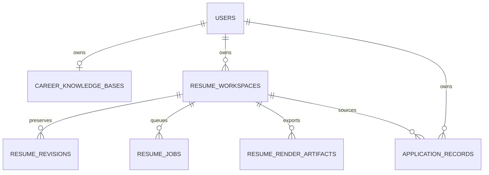

# ManifestCV Database Design

---

ManifestCV product data is owned by the signed in user and is separate from Mystic Auth's identity, authorization, and audit tables.

## Product tables

---

| Table | Purpose |
|---|---|
| `career_knowledge_bases` | One private source knowledge base per user |
| `resume_workspaces` | Resume title, target job description, template, status, and current revision |
| `resume_revisions` | Immutable structured document revisions for each workspace |
| `resume_jobs` | Background generation and export job state |
| `resume_render_artifacts` | Generated PDF artifact metadata and storage references |
| `application_records` | Job tracking records and copied Resume Studio snapshots |

## Relationships

---

Workspace revisions preserve the exact structured document used for editing, approval, and export. Application records copy the approved document and export metadata so tracking history remains stable after later workspace edits.

## Ownership and deletion

---

Every product record is scoped to its user. Account deletion cascades through user owned product data. Deleting a workspace removes its revisions and jobs. Deleting an application does not change the source workspace.

## Migrations

---

The schema is managed by Alembic under `backend/alembic/versions/`. The Resume Studio migration chain adds workspaces, revisions, jobs, template metadata, and application snapshot fields after the existing application tables. Runtime startup does not call `create_all()`.
