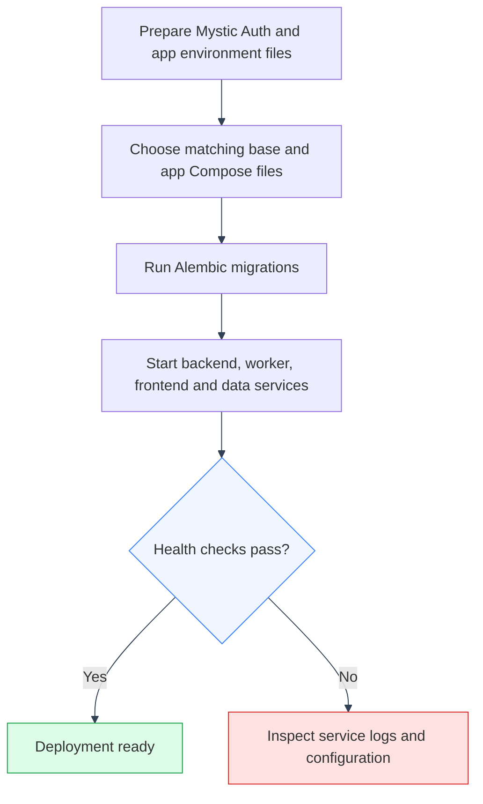

# Deployment Guide
---

> Commands below assume you're at the repository root, unless a `cd` is shown explicitly.



---

## Dev vs. Local-prod vs. Prod

Five Compose files (all under `docker/mystic_auth/compose/`), three deployment shapes:

| | `docker-compose.dev.yml` | `docker-compose.local-prod-{cloudflare,ngrok,tailscale}.yml` | `docker-compose.prod.yml` |
|---|---|---|---|
| Frontend | Vite dev server (HMR) | nginx serving the static build | nginx serving the static build |
| Source code | Bind-mounted from host | Baked into the image | Baked into the image |
| Backend/worker reload | `--reload` on file change | Off | Off |
| Restart policy | `always` on postgres/valkey/qdrant/bugsink. App services (backend/frontend/worker) have none, so you restart manually | `unless-stopped` on long-running services | `unless-stopped` on long-running services |
| Qdrant | Included, host port `6333` published for local inspection | Included, internal service only | Included, internal service only |
| Public entrypoint | None (local only) | `cloudflared`/`ngrok`/`tailscale` (one per file), outbound tunnel. No domain, no inbound ports | `caddy`: automatic Let's Encrypt TLS, requires a real domain pointed at the host |

Each `docker-compose.local-prod-{cloudflare,ngrok,tailscale}.yml` is for self-hosting a production-style build without owning a server with a public IP or domain: the matching tunnel container opens an outbound connection to that provider's edge, so nothing needs inbound port-forwarding. The upstream base plus the matching app override includes Postgres, Valkey, app-owned Qdrant, backend, frontend, the Procrastinate worker, Alembic, Bugsink, and Bugsink seeding.

`docker-compose.prod.yml` is for an actual internet-facing deployment (a VPS) where you do have a domain: `caddy` terminates TLS itself via `PUBLIC_DOMAIN`/`ACME_EMAIL` and is the only container with ports published to the host. `postgres`, `valkey`, app-owned `qdrant`, `backend`, and `frontend` are reachable only container-to-container.

Local development:

```bash
docker compose -f docker/mystic_auth/compose/docker-compose.dev.yml -f docker/app/compose/docker-compose.dev.yml --env-file env/mystic_auth/.env.dev --env-file env/app/.env.dev up
```

Self-hosted local-prod (no domain needed - Cloudflare Tunnel shown, swap the file/env-file pair for `-ngrok`/`-tailscale`):

```bash
docker compose -f docker/mystic_auth/compose/docker-compose.local-prod-cloudflare.yml -f docker/app/compose/docker-compose.local-prod-cloudflare.yml --env-file env/mystic_auth/.env.local-prod-cloudflare --env-file env/app/.env.local-prod-cloudflare up -d --build
```

Real deployment (own server, own domain):

```bash
docker compose -f docker/mystic_auth/compose/docker-compose.prod.yml -f docker/app/compose/docker-compose.prod.yml --env-file env/mystic_auth/.env.prod --env-file env/app/.env.prod up -d --build
```

`VITE_API_BASE_URL`/`VITE_APP_NAME`/`VITE_SENTRY_DSN`/`VITE_SENTRY_ENVIRONMENT` are Vite build-time vars, baked into the frontend bundle. Set their real production values in the matching `env/app/.env.prod` (or `env/app/.env.local-prod-*`) before building - Compose interpolates `${VAR}` from that app-owned file. Exporting them in the shell instead (`export VITE_API_BASE_URL=...`) works too and overrides the file, useful for a CI pipeline that shouldn't have a checked-out env file at all. Either way, a production build with these unset ships the frontend bundle with `undefined` baked in.

See [Docker Overview](../docker/overview.md) for the full service breakdown of all five files.

---

## Required production environment variables

Same template variables as `env/mystic_auth/.env.prod.example`, plus app variables in `env/app/.env.prod.example`, with these called out specifically for production:

- `ENVIRONMENT=production`: disables `/docs`, `/redoc`, and `/openapi.json` on the backend (see `backend/app/main.py`).
- `SECRET_KEY`, `GOOGLE_CLIENT_SECRET`, `GMAIL_APP_PASSWORD`, `POSTGRES_PASSWORD`: generate/rotate these for production. Never reuse the values from local `env/mystic_auth/.env*` files or CI.
- `VALKEY_PASSWORD`: production Compose refuses to start if this is unset or empty, unlike the dev compose file, where an empty value is a deliberate local-only convenience. Valkey backs rate limiting and login lockout, so running it unauthenticated in production is never acceptable even on an isolated network.
- `FRONTEND_BASE_URL` / `BACKEND_BASE_URL`: must point at the real production hostnames. CORS (`main.py`) only allows the single origin configured here.
- `TRUSTED_PROXY_IPS`: not set directly in `env/mystic_auth/.env.prod` (or any `env/mystic_auth/.env.local-prod-*`) - `docker-compose.prod.yml` derives and overrides it from `FRONTEND_STATIC_IP`/`CADDY_STATIC_IP` (same pattern per local-prod variant, with that provider's own static-IP var), so it can't drift out of sync with those. `frontend` sits between the reverse proxy and the backend and is pinned to that static address for exactly this: per-IP rate limiting/lockout resolve the real client IP from `X-Forwarded-For` instead of collapsing onto that address for every request. See [Docker: Compose Modes](../../mystic_auth/docker/compose-modes.md).
- `GEMINI_API_KEY`: required. Without it the backend fails to start (`core/settings.py` has no default). Get one at [aistudio.google.com/apikey](https://aistudio.google.com/apikey).
- `QDRANT_URL`: defaults to the Compose service URL `http://qdrant:6333` for all Docker modes. Change it only when using external Qdrant or Qdrant Cloud.

### Tighten the frontend's CSP to your real API origin

`docker/mystic_auth/nginx.frontend.conf`'s `Content-Security-Policy` header ships with `connect-src 'self' http: https:`, deliberately permissive because the real backend origin (`VITE_API_BASE_URL`) is a runtime-configurable build arg nginx's static config can't know ahead of time. As shipped, this means CSP provides close to no protection against a `fetch()` to an arbitrary third-party origin if an XSS bug is ever introduced elsewhere. **Before a real deployment**, edit `docker/mystic_auth/nginx.frontend.conf` to replace `http: https:` in `connect-src` with your actual API origin (e.g. `connect-src 'self' https://api.example.com;`) and rebuild the frontend image. This is a config-file edit, not an env var, since nginx's config is baked into the image at build time. (No `frame-src` tightening is needed: the resume template preview `<iframe>` embeds a same-origin `blob:` URL built client-side, not a direct cross-origin `<iframe src>`. See [Document Generation](../document-generation/overview.md) and [Docker Overview](../docker/overview.md).)

---

## Database migrations

The `alembic` service runs `alembic upgrade head` once and exits. `backend` and `procrastinate_worker` both wait on it (`depends_on: alembic: condition: service_completed_successfully` in `docker-compose.prod.yml`) so nothing serves traffic against a schema that hasn't been migrated yet.

Before applying a migration in production, review the generated migration script under `backend/alembic/versions/`: especially anything that drops or alters a column/table. Alembic's autogenerate is a starting point, not a guarantee of safety. A destructive migration should be reviewed like any other schema change before `alembic upgrade head` runs against production data.

### Rolling back a bad deploy or migration

Two independent things can go wrong with a release, and they're rolled back differently:

- **Bad application code, schema unaffected**: redeploy the previous image tag/commit (`docker compose -f docker/mystic_auth/compose/docker-compose.prod.yml -f docker/app/compose/docker-compose.prod.yml --env-file env/mystic_auth/.env.prod --env-file env/app/.env.prod up -d --build` against the prior revision, or `docker service update --rollback` / your orchestrator's equivalent if not using bare Compose). Since `backend`, `procrastinate_worker`, and `alembic` all build from the same image, redeploying is a single image swap. No separate rollback step per service.
- **Bad migration**: `alembic downgrade -1` (or a specific revision, `alembic downgrade <revision>`) reverses the most recent migration, run the same way `alembic upgrade head` is (`docker compose -f docker/mystic_auth/compose/docker-compose.prod.yml -f docker/app/compose/docker-compose.prod.yml --env-file env/mystic_auth/.env.prod --env-file env/app/.env.prod run --rm alembic alembic downgrade -1`). This only works if the migration's own `downgrade()` is correct and non-destructive-in-reverse (e.g. a dropped column's data is gone regardless of downgrading the schema back), which is exactly why the migration review step above matters *before* `upgrade head` runs, not just after something breaks. If the migration already ran a destructive, `downgrade()`-unsafe change (e.g. a `DROP COLUMN`), the real recovery path is the database backup above, not `alembic downgrade`.

In both cases, take a fresh `scripts/mystic_auth/db/database-backup/database-backup.sh` snapshot before attempting the rollback itself. A rollback that goes wrong should never be the only copy of "what the data looked like right before this."

---

## Backups

`scripts/mystic_auth/db/database-backup/database-backup.sh` and `scripts/mystic_auth/db/database-restore/database-restore.sh` wrap the `pg_dump`/`psql` commands below. They read `POSTGRES_USER`, `POSTGRES_DB`, and `BACKUP_ENCRYPTION_KEY` from the matching upstream/app env pair, run through Docker, and make no cloud/provider assumptions. Backups are encrypted `.dump.enc` files containing both the app database and Bugsink database.

```bash
# Dump the running postgres service to backups/<db>-<timestamp>.dump.enc
scripts/mystic_auth/db/database-backup/database-backup.sh
# Against the production compose file instead of the dev one:
scripts/mystic_auth/db/database-backup/database-backup.sh docker-compose.prod.yml

# Restore a dump (prompts for confirmation; -y skips the prompt)
scripts/mystic_auth/db/database-restore/database-restore.sh backups/manifest_cv-20260717-120000.dump.enc docker-compose.prod.yml
```

These scripts are the "how", not the "when". There's still no scheduler wired up in this repo, since no specific production host/cloud target is assumed (see [Concerns](../concerns/README.md)). Wire `scripts/mystic_auth/db/database-backup/database-backup.sh` into whatever your host provides, such as cron, a systemd timer, managed Postgres backups, or a sidecar container, on a schedule that matches your data's change rate (daily is a reasonable default for most small apps). Store the dumps somewhere durable off the host, and periodically test a restore. An untested backup is not a backup.

Equivalent raw commands, if you'd rather not use the scripts:

```bash
docker compose exec postgres pg_dump -U $POSTGRES_USER $POSTGRES_DB > backup-$(date +%F).sql
docker compose exec -T postgres psql -U $POSTGRES_USER $POSTGRES_DB < backup-2026-07-13.sql
```

---

## Error monitoring

Starts by default. `docker compose -f docker/mystic_auth/compose/docker-compose.prod.yml -f docker/app/compose/docker-compose.prod.yml --env-file env/mystic_auth/.env.prod --env-file env/app/.env.prod up -d --build` brings up Bugsink and the one-shot `bugsink-seed` service alongside the rest of the production stack. The seed service writes the backend DSN into the shared Docker volume after Bugsink is healthy. `VITE_SENTRY_DSN` still needs to be set manually because the browser DSN must use the public Bugsink URL and is baked into the frontend bundle at build time.

`docker-compose.prod.yml` exposes no host port for `bugsink` by default (unlike `frontend`, which is meant to be internet-facing via `caddy`). Reaching it means an SSH tunnel, a VPN, or setting `BUGSINK_PUBLIC_DOMAIN` in `.env` and uncommenting its route in `docker/mystic_auth/Caddyfile`, which gives it its own TLS-terminated public route the same way `PUBLIC_DOMAIN` does for the frontend. See [Error Monitoring](../../mystic_auth/error-monitoring/overview.md) for the full setup: env vars, DSN wiring, the internal-vs-browser DSN split that matters even more once the backend isn't on `localhost`, and self-hosted Bugsink vs. Sentry's hosted tier.

---

## Graceful shutdown

`backend/app/main.py` registers a FastAPI `lifespan` handler that runs on shutdown (e.g. `docker stop`, or a rolling restart under an orchestrator): it disposes the SQLAlchemy connection pool and closes the Valkey client cleanly instead of relying on the process dying and the OS reclaiming the sockets.

---

## Free / low-cost hosting options

This stack has five pieces that need hosting: backend (containerized FastAPI), frontend (static SPA build), Postgres, Valkey plus two background worker processes, and Qdrant. None of the options below are endorsed as production-ready without your own evaluation of their limits (cold starts, storage caps, free-tier sleep policies). They're a reasonable starting point for a small deployment, not a guarantee.

### Backend (FastAPI, containerized)

- **Render** (free/hobby web service tier). Deploys directly from `docker/mystic_auth/dockerfiles/backend.Dockerfile`. Supports a separate "background worker" service type for `procrastinate_worker` on the same repo. Free tier sleeps after inactivity (cold-start latency).
- **Fly.io**: deploys any Dockerfile. Has a small free allowance. Good fit since the app is already fully containerized.
- **Railway**: Dockerfile-based deploys, usage-based free tier.

### Frontend (static SPA build)

- **Vercel** / **Netlify** / **Cloudflare Pages**: all have generous free tiers for a static build (`npm run build` to `frontend/dist/`). None need the `production` nginx image specifically, since they serve the static files themselves. If you do want the containerized nginx path (`docker/mystic_auth/dockerfiles/frontend.Dockerfile --target production`), use the same host as the backend instead.

### PostgreSQL

- **Neon**, **Supabase**, or **Railway**: all offer a free managed Postgres tier reachable over the internet. Set `DATABASE_URL` to the provided connection string (must use the `postgresql+asyncpg://` scheme this app's async engine expects, not `postgresql://`).

### Valkey

- **Upstash**: hosted Valkey with a free tier, reachable over TLS from any host. Set `VALKEY_URL` accordingly. Note the free tier's request-count limits matter here since Valkey is used for rate limiting and lockout (both high-frequency).

### Background worker (Procrastinate)

One long-running process, not a request-driven serverless function. Render's/Railway's "background worker" service type (pointed at the same image) fits it, among the free-tier options above:

- **Worker**: `command: procrastinate --app=mystic_auth.procrastinate_tasks.procrastinate_app.app worker`. Consumes the email-sending and daily account-purge task queue. Postgres-native (the queue lives in `procrastinate_jobs`, migrated in by Alembic like any other table), so no separate broker or scheduler process is needed. Retries and backoff are handled by Procrastinate in this one process. See [Background Email Delivery](../../mystic_auth/background-workers/procrastinate.md).

### Qdrant

- **Self-hosted, same host as the backend**: the `qdrant/qdrant` image (see [Docker Overview](../docker/overview.md)) has no external dependencies and a small footprint. The app Compose overrides already run it alongside `backend`/`procrastinate_worker`/`postgres`/`valkey`; use the same pattern for Render/Fly/Railway sidecars if deploying outside Compose.
- **Qdrant Cloud**: a managed free tier exists if self-hosting isn't an option. Set `QDRANT_URL` to the provided cluster URL. Self-hosting alongside the backend is the tested Compose path.

### Practical combination for a $0 deployment

Backend + worker + Qdrant on Render, frontend on Vercel or Netlify, Postgres on Neon, Valkey on Upstash, and Gemini's free tier for AI calls. Set `TRUSTED_PROXY_IPS` appropriately if the chosen backend host places its own reverse proxy in front of your container. Otherwise per-IP rate limiting will silently collapse onto that proxy's IP for every request.

---

## Limitations of this deployment approach

- No infrastructure-as-code (Terraform/Pulumi/etc.) is provided. The steps above are manual, per-provider console/CLI actions.
- No automated backups, uptime/infrastructure monitoring, or alerting are wired up anywhere in this repo. See [Concerns](../concerns/README.md). (Error tracking is available, see [Error Monitoring](../../mystic_auth/error-monitoring/overview.md) above: it's on by default but only captures application exceptions, not infra health/uptime, and doesn't send alerts anywhere on its own. You still have to check Bugsink's Issues list, or wire its notifications up yourself.)
- Free tiers on the providers above typically have cold-start latency, storage caps, and request-volume limits not suitable for real production traffic. Treat this section as a starting point for a demo/side-project deployment, not a scaling plan.
