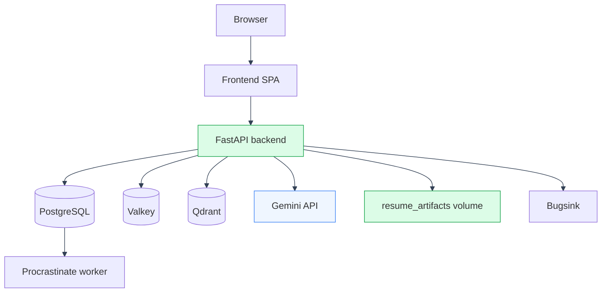

# Docker Overview

---

Docker runs the complete ManifestCV stack with Mystic Auth as its identity foundation. Every command uses the upstream Compose file together with the matching app override and both environment files.

---

## Services

| Service | Purpose |
|---|---|
| `postgres` | Durable application, identity, audit, and task queue storage |
| `valkey` | Ephemeral cache, rate limits, lockout counters, and single-use tokens |
| `qdrant` | Per-user career knowledge vector search |
| `backend` | FastAPI API, Resume Studio rendering, and export jobs |
| `frontend` | Vite development server or production nginx SPA |
| `procrastinate_worker` | Background email and account lifecycle tasks |
| `alembic` | One-shot database migration runner |
| `bugsink` and `bugsink-seed` | Self-hosted error monitoring and its idempotent bootstrap |

The backend, worker, and migration runner use the same image with different commands. The app Compose overrides mount the named `resume_artifacts` volume at `/var/lib/manifestcv/resume-artifacts`, keeping exported PDFs across backend image replacement and container recreation.

---

## Compose modes

There are five modes. Each combines one file under `docker/mystic_auth/compose/` with the matching file under `docker/app/compose/`.

| Mode | Frontend | Public entrypoint |
|---|---|---|
| Development | Vite with hot reload | None |
| Local production with Cloudflare | Baked nginx build | Cloudflare tunnel |
| Local production with ngrok | Baked nginx build | ngrok tunnel |
| Local production with Tailscale | Baked nginx build | Tailscale funnel |
| Production | Baked nginx build | Caddy with TLS |

Development example:

```bash
docker compose \
  --env-file env/mystic_auth/.env.dev \
  --env-file env/app/.env.dev \
  -f docker/mystic_auth/compose/docker-compose.dev.yml \
  -f docker/app/compose/docker-compose.dev.yml \
  up -d --build
```

The app environment file is loaded last so app-owned values win when a setting is intentionally shared.

---

## Runtime topology



---

## Healthchecks and migrations

- `postgres` reports healthy through `pg_isready`.
- `valkey` reports healthy through `valkey-cli ping`.
- `backend` reports healthy through `GET /health/ready`, which verifies database, Valkey, and GeoIP availability.
- The production frontend reports healthy through nginx and `wget`.
- `procrastinate_worker` uses its worker healthcheck instead of the backend HTTP healthcheck.
- `alembic` must complete successfully before the backend and worker start.

Alembic owns the schema. Run `alembic check` after model changes to detect migration drift. Historical revisions remain in the chain for databases created before the current Resume Studio flow; the retired tables are excluded from active application metadata.

---

## Docker testing

The test image is selected with `BACKEND_BUILD_TARGET=test`, which adds pytest and static analysis tools without shipping them in the runtime image. The app backend suite runs inside the Docker network so it reaches `postgres`, `valkey`, and `qdrant` by service name.

```bash
docker compose exec -w /repo backend python -m pytest tests/backend/app -q
docker compose exec -w /repo frontend npm run test -- --run
```

The production image also contains the real `tectonic` compiler. Resume Studio export tests therefore verify the same PDF compilation dependency used by the running service.

---

## See also

- [Testing Overview](../testing/overview.md)
- [Deployment Guide](../deployment/guide.md)
- [Document Generation](../document-generation/overview.md)
