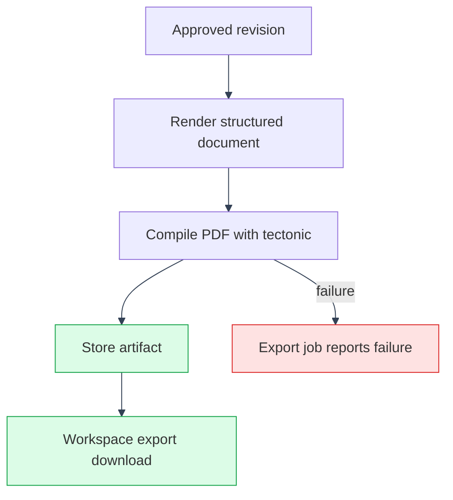

# Resume Studio Export

---

Resume Studio exports an approved structured workspace as a PDF. Export is part of the workspace flow and is available from the builder after approval.

## Flow

---

---

1. The user chooses a template during workspace setup.
2. The builder stores the structured document as revisions.
3. The user approves the current revision when it is ready.
4. The backend renders the document through `backend/app/resume_builder/render_service.py`.
5. The export job stores the generated artifact and exposes it through the workspace export route.
6. Applications can copy the approved document and PDF metadata into an immutable application snapshot.

## Backend

---

Resume document schemas and templates live in `backend/app/resume_builder/`. `html_renderer.py` provides preview markup and `render_service.py` produces the final PDF. Background generation and export jobs live in `api/resume_builder_routes/job_routes.py` and the Resume Studio task module.

Generated artifacts are written below `RESUME_STORAGE_ROOT`. The app Compose overrides mount the named `resume_artifacts` volume at `/var/lib/manifestcv/resume-artifacts`, so generated PDFs survive backend image replacement and container recreation. Production object storage can be configured through the storage settings in `backend/app/storage/object_store.py`.

## API

---

See [API Reference](../api/reference.md#resume-studio) for workspace preview, export job, job status, and download routes.
