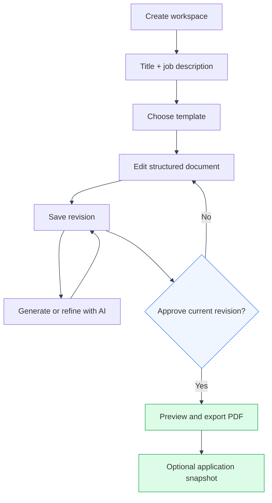
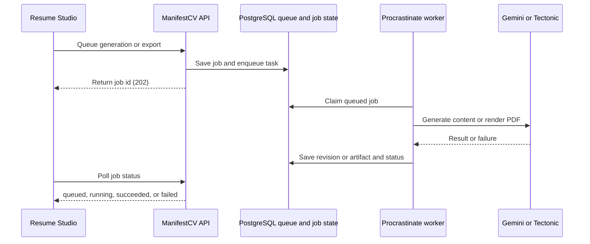

# Resume Studio

---

Resume Studio is ManifestCV's workspace for building tailored resumes. Each workspace keeps the job description, selected template, current structured document, and revision history together.

## Product flow

---

---

1. Open Resume Studio and create a workspace.
2. Add a resume title and the target job description.
3. Review the available layouts and choose a template.
4. Edit the document on the canvas with the block library and inspector.
5. Generate or refine content with the career knowledge base when needed.
6. Review revisions, approve the document, and export the finished resume.

## Frontend

---

The active flow lives in `frontend/src/app/resume_builder/`:

- `ResumeWorkspacesPage.tsx` lists workspaces and starts a new one.
- `ResumeSetupPage.tsx` collects the title and job description.
- `ResumeTemplatePickerPage.tsx` previews and selects layouts.
- `ResumeBuilderPage.tsx` provides the document canvas, inspector, block library, AI refinement, revision history, and export controls.

The routes are `/resume-builder`, `/resume-builder/new`, `/resume-builder/new/templates`, and `/resume-builder/:workspaceId`.

## Backend

---

The workspace API lives under `/resume-workspaces`. It provides template catalog, workspace creation, document saves, generation, refinement, revision history, restore, approval, background jobs, and export. Workspace ownership is enforced for every user resource.

### Background jobs

Generation and PDF export are queued on the shared Procrastinate worker. The API returns a job id, and the frontend polls `/resume-jobs/{job_id}` until the job succeeds or fails. A successful generation creates a new revision; a successful export stores a PDF artifact. See [API Reference](../api/reference.md#resume-studio) for the job and download routes.

The structured document schema is defined in `backend/app/resume_builder/document_schema.py`. Templates are defined in `backend/app/resume_builder/templates.py`. Revision rows preserve each saved document and its change kind so the editor can restore earlier work safely.

## Related areas

---

Career Knowledge supplies the private source material used for generation and refinement. Applications store a snapshot of the selected resume at the time an application is tracked. Document export is part of the Resume Studio workspace flow.
